<p align="center"><a href="README.md">Français</a> · <b>English</b></p>

<p align="center">
  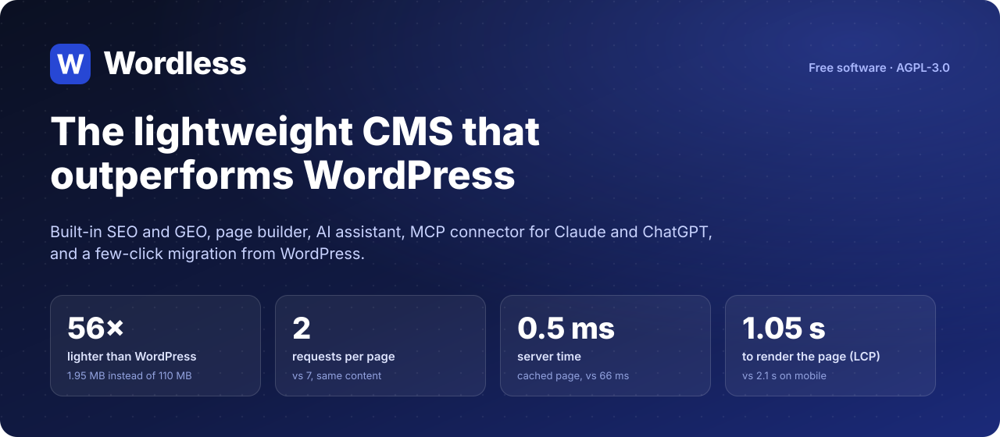
</p>

<p align="center">
  <a href="LICENSE"></a>
  
  
  
  
  
</p>

<p align="center">
  <a href="https://github.com/Jacckisback/Wordless/raw/main/dist/wordless-1.0.0.zip"><b>Download Wordless 1.0</b></a> (606 KB)
  · <a href="#installation">Install in 3 minutes</a>
  · <a href="#migrate-from-wordpress">Migrate from WordPress</a>
  · <a href="docs/BENCHMARK.md">See the benchmark</a>
</p>

---

# Wordless: the lightweight, fast and secure CMS, a WordPress alternative

**Wordless is a PHP CMS that does what WordPress does, plus what WordPress hands off to a dozen plugins, in a package 58 times lighter.** A visual page builder, built-in SEO and GEO (visibility in Google *and* in ChatGPT, Claude, Perplexity), an AI writing assistant, an MCP connector to run the site from Claude or ChatGPT, hardened security and a complete dashboard: everything is included and configured from the first minute.

Moving from WordPress takes **a few clicks**, with **the same URLs**: your pages keep their rankings and your links keep working.

<p align="center">
  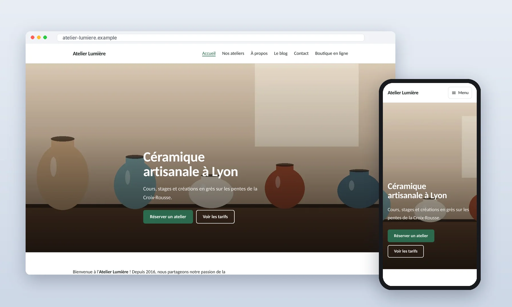
</p>

> **Every number on this page is measured, not estimated.** The “Atelier Lumière” WordPress demo site (WordPress 7.1.4, default theme) was migrated to Wordless with the built-in tool, then both versions were compared on the same machine. Full method and results (in French): [docs/BENCHMARK.md](docs/BENCHMARK.md).

## Contents

- [At a glance](#at-a-glance)
- [Wordless vs WordPress](#wordless-vs-wordpress)
- [Speed: less code, better results](#speed-less-code-better-results)
- [Built-in SEO, no plugin](#built-in-seo-no-plugin)
- [GEO: get cited by AI](#geo-get-cited-by-ai)
- [Visual page builder](#visual-page-builder)
- [AI assistant to write and optimize](#ai-assistant-to-write-and-optimize)
- [AI art director](#ai-art-director)
- [MCP connector: Claude and ChatGPT at the controls](#mcp-connector-claude-and-chatgpt-at-the-controls)
- [Migrate from WordPress](#migrate-from-wordpress)
- [360° dashboard](#360-dashboard)
- [Security](#security)
- [Installation](#installation)
- [For developers](#for-developers)
- [FAQ](#faq)
- [Known limitations](#known-limitations)
- [License and credits](#license-and-credits)

---

## At a glance

| Strength | In practice |
|---|---|
| **58× lighter** | 1.9 MB and 170 files, vs 110 MB and 3,782 files for WordPress 7.1.4. |
| **6× less data per page** | 42 KB and 2 requests for the demo home page, vs 252 KB and 7 requests with WordPress. |
| **0.5 ms server response** | Pages are served from a built-in cache, without booting the application or touching the database. |
| **2× faster rendering** | 1.05 s mobile LCP vs 2.10 s (Lighthouse 13.6), Lighthouse SEO 100 vs 92. |
| **SEO and GEO out of the box** | Structured data, sitemaps, `llms.txt`, a Markdown version of every page, SEO and GEO scores on every edit. |
| **Built-in AI** | Writing, FAQs, meta descriptions, alt text, translation into 6 languages, an art director, with your own Claude or OpenAI key. |
| **MCP connector** | Claude.ai, ChatGPT, Claude Code or Cursor read, write and publish on your site, with your account's permissions. |
| **A few-click migration** | Content, images, menus, comments, authors and SEO settings carried over, same URLs, automatic 301 redirects. |
| **Zero dependencies** | PHP 8.1 and SQLite: no MySQL to set up, no Composer, no npm. Runs on ordinary shared hosting. |

---

## Wordless vs WordPress

<picture>
  <source media="(prefers-color-scheme: dark)" srcset=".github/assets/bench-en-dark.svg">
  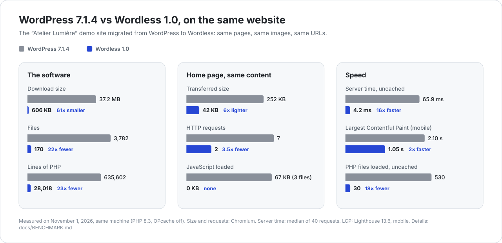
</picture>

### The numbers, on the same website

The “Atelier Lumière” site (7 pages, 11 posts, 5 images, menus, comments) was built on WordPress 7.1.4 with its default theme, then migrated to Wordless with the built-in tool. Same content, same images, same URLs.

| Metric | WordPress 7.1.4 | Wordless 1.0 | Difference |
|---|---:|---:|---:|
| Download size | 37.2 MB | 606 KB | 61× smaller |
| Installed size | 110.1 MB | 1.9 MB | 58× lighter |
| Number of files | 3,782 | 170 | 22× fewer |
| Lines of PHP | 635,602 | 28,018 | 23× fewer |
| Home page weight | 252 KB | 42 KB | 6× lighter |
| Requests to render the home page | 7 | 2 | 3.5× fewer |
| JavaScript on the home page | 67 KB (3 files) | 0 | none |
| Web font downloaded | 52 KB | 0 | system fonts |
| Weight of a blog post | 346 KB (11 requests) | 54 KB (3 requests) | 6.4× lighter |
| Server time, cached page | no built-in cache | 0.5 ms | |
| Server time, uncached | 65.9 ms | 4.2 ms | 16× faster |
| PHP files loaded per page | 530 | 4 cached, 30 uncached | |
| SQL queries per page | 32 | 0 cached, 24 uncached | |
| PHP memory per page | 10 MB | 2 MB | 5× less |

### Lighthouse, mobile (median of 3 runs)

| | WordPress, home | Wordless, home | WordPress, post | Wordless, post |
|---|:---:|:---:|:---:|:---:|
| Performance | 99 | **100** | 99 | **100** |
| Accessibility | 98 | 98 | 100 | 100 |
| Best practices | 100 | 100 | 100 | 100 |
| SEO | 92 | **100** | 92 | **100** |
| First Contentful Paint | 1.20 s | **0.85 s** | 1.35 s | **0.87 s** |
| Largest Contentful Paint | 2.10 s | **1.05 s** | 2.01 s | **1.05 s** |

WordPress already scores well on performance with its default theme: the gap shows in real rendering time (LCP is cut in half), page weight and server work. SEO goes from 92 to 100 because Wordless writes a meta description as soon as you publish, which WordPress does not do without a plugin.

<details>
<summary><b>Test conditions</b></summary>

Same machine, PHP 8.3.6, PHP built-in server, OPcache off for both. WordPress runs with the official *SQLite Database Integration* plugin (no MySQL server in the test environment). Weight and requests measured in Chromium, server time as the median of 40 requests, scores with Lighthouse 13.6 in mobile mode. With MySQL and OPcache, WordPress answers faster than here, and so does Wordless: the order of magnitude holds. Details and commands to reproduce (in French): [docs/BENCHMARK.md](docs/BENCHMARK.md).
</details>

### What WordPress hands off to plugins, Wordless builds in

| Need | WordPress 7.1.4 (core) | Plugin often added | Wordless 1.0 |
|---|---|---|---|
| Meta descriptions, SEO titles, analysis | no | Yoast SEO, Rank Math | built in, live score |
| Structured data (JSON-LD) | no | Yoast SEO, Rank Math, Schema Pro | built in: article, FAQ, how-to, video, breadcrumbs, organization |
| XML sitemap | yes, without images | Yoast SEO, Rank Math | built in, with images |
| `llms.txt`, Markdown version of pages | no | specialized plugins | built in |
| Choosing which AI crawlers are allowed | no | hand-edited robots.txt | built in, crawler by crawler |
| Page cache | no | WP Rocket, W3 Total Cache | built in, on by default |
| WebP images in several sizes | multiple sizes, no WebP conversion | Imagify, EWWW | built in |
| Page builder | Gutenberg block editor | Elementor, Divi | built in, edit directly on the page |
| 301 redirects and 404 tracking | old post slugs only | Redirection | built in: redirects, 404 log, suggestions |
| Two-factor authentication | no | Wordfence, Two Factor | built in (TOTP + recovery codes) |
| Login attempt limiting | no | Limit Login Attempts, Wordfence | built in, progressive lockout |
| Visitor analytics | no | Site Kit, MonsterInsights (+ cookie banner) | built in, cookie-free |
| Backups | no | UpdraftPlus | built in, daily |
| AI writing assistant | developer AI API, “Connectors” screen | AI Engine, AI plugins | built in, ready to use |
| MCP server | no | MCP Adapter plugin | built in, OAuth 2.1 |
| Contact form | no | Contact Form 7, WPForms | built in, anti-spam |

Every plugin adds code that runs on each visit, updates to watch and attack surface. According to Patchstack, **93% of the WordPress vulnerabilities recorded in 2022 were in plugins**, 6.7% in themes and 0.6% in core ([source](https://wptavern.com/patchstack-tracks-328-more-security-bugs-reported-in-wordpress-plugins-in-2022)).

> **What WordPress does better, honestly.** An ecosystem of tens of thousands of plugins and themes, e-commerce with WooCommerce, multisite, an admin translated into dozens of languages and a huge community. If your site depends on those, stay on WordPress. Wordless targets brochure sites, blogs, experts, craftspeople and small businesses that want speed, search visibility and simplicity without maintaining a stack of plugins.

---

## Speed: less code, better results

<picture>
  <source media="(prefers-color-scheme: dark)" srcset=".github/assets/flow-en-dark.svg">
  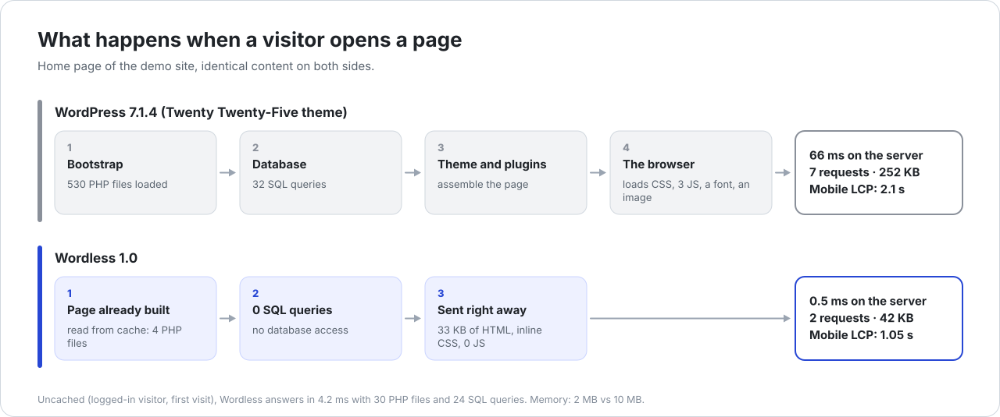
</picture>

A lighter site is not a site that does less: it is a site that **only** does what the visitor needs.

- **Cache served before the application.** For a visitor, Wordless reads the already-built page and sends it: 4 PHP files, no SQL query, 0.5 ms. The cache refreshes itself whenever you publish or edit content.
- **Zero JavaScript on the public site.** The mobile menu works with native HTML. Only pages that contain a video load a script under 1 KB, and the YouTube or Vimeo player loads only when the visitor clicks.
- **Inline CSS.** A single request renders the page, with no render-blocking stylesheet. Its hash is allowed by a strict security policy.
- **Automatic image optimization.** Every uploaded image is rotated, recompressed, converted to WebP and resized into 3 widths (480, 960 and 1,440 px); the browser picks the right one. Lazy loading below the fold, priority for the main image.
- **System fonts.** 13 carefully chosen font stacks, no download. A Google font can be installed on your own server (nothing is loaded from Google, GDPR friendly).
- **SQLite in WAL mode.** A database in a single file, no server to manage, fast reads.

**What it changes:** better Core Web Vitals (a Google ranking factor), mobile visitors who stay, modest hosting that is enough, and less data transferred on every visit.

---

## Built-in SEO, no plugin

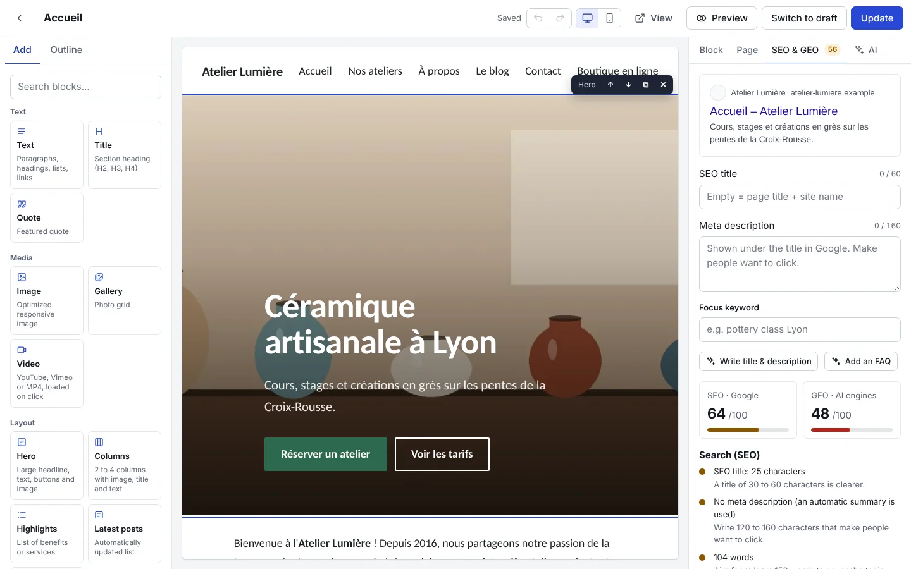

Every page is analyzed while you write. The **SEO & GEO** tab shows the Google preview, two scores out of 100 and concrete advice, ranked by importance.

**What Wordless does for you, with no setup:**

- **Tags**: SEO title with a template (`{title} – {site}`), meta description (written by you, by the AI or generated automatically), canonical URL, Open Graph and Twitter/X cards, default share image.
- **JSON-LD structured data**: organization or person, website with site search, page, breadcrumbs, article (BlogPosting, Article, NewsArticle), FAQ, how-to, video, image.
- **XML sitemaps** per content type, with images, declared in `robots.txt`. **IndexNow** notifies Bing, Yandex and Seznam on every publication.
- **Clean, configurable URLs** (`/{slug}`, `/{year}/{month}/{slug}`, `/{category}/{slug}`…), trailing slash as you prefer.
- **Automatic 301 redirects** when a URL changes (child pages included), a redirect manager with CSV import, and a **404 log** that suggests the closest existing page.
- **Google Search Console, Bing and Yandex verification** by pasting the code.

**The SEO analysis checks:** title and meta description length, H2 headings and heading order, image alt text, internal links, featured image, URL length, focus keyword placement (title, description, introduction, subheadings, URL) without overuse, readability, duplicate titles, pages excluded from Google.

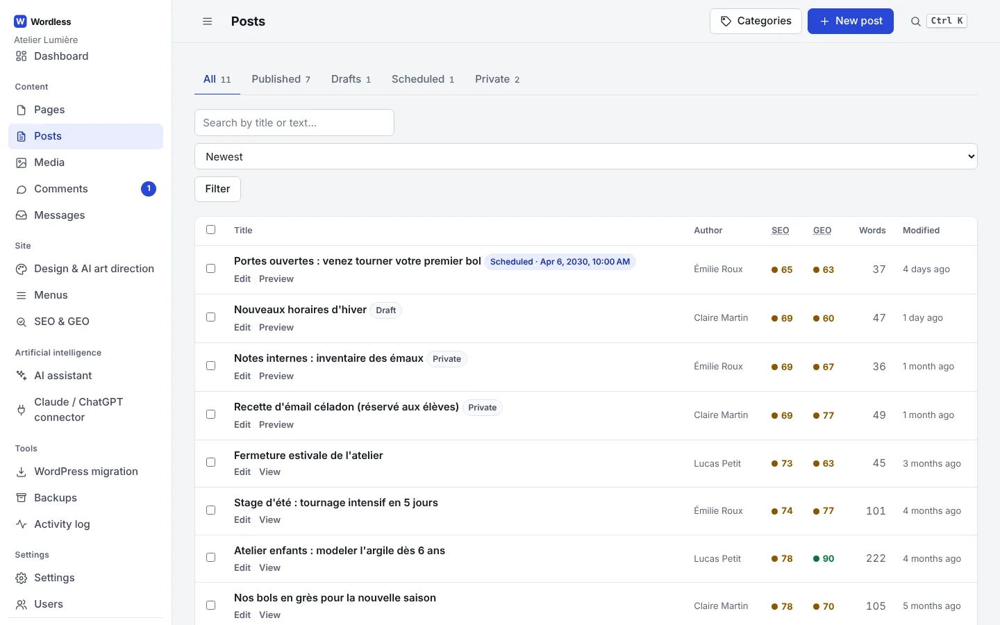

---

## GEO: get cited by AI

<picture>
  <source media="(prefers-color-scheme: dark)" srcset=".github/assets/geo-en-dark.svg">
  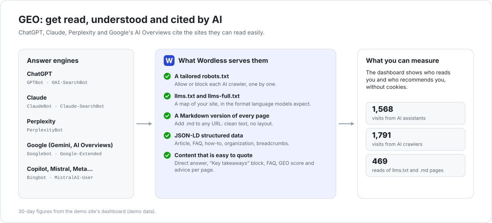
</picture>

**GEO** (Generative Engine Optimization) means being read, understood and **cited** by answer engines: ChatGPT, Claude, Perplexity, Gemini, Copilot and Google's AI Overviews. A growing share of searches ends with their answer; being the cited source matters as much as ranking first on Google.

**Wordless handles it out of the box:**

- **`/llms.txt` and `/llms-full.txt`**, a map of your site in the format proposed for language models.
- **A Markdown version of every page**: add `.md` to any URL (`/my-post.md`) to get clean text with no layout. These versions are not indexed by Google (no duplicate content).
- **Per-crawler control of AI bots**: GPTBot, OAI-SearchBot, ChatGPT-User, ClaudeBot, Claude-SearchBot, Claude-User, PerplexityBot, Perplexity-User, Google-Extended, Applebot-Extended, Meta-ExternalAgent, CCBot… You decide who may train on your content and who may cite it.
- **Blocks designed to be quoted**: “Key takeaways” (summary in bullets), tagged FAQ, steps (HowTo), table of contents.
- **A GEO score out of 100 for every page**, which checks: a direct answer in the introduction (40 to 60 words), subheadings phrased as questions, an FAQ with at least 3 questions, lists, tables and steps, dated figures, sources cited with a link, an expert or customer quote, an identified author with a bio (E-E-A-T), content freshness, AI crawlers allowed.
- **Measurement**: the dashboard counts visits from AI assistants, visits from AI crawlers and reads of `llms.txt` and `.md` pages.

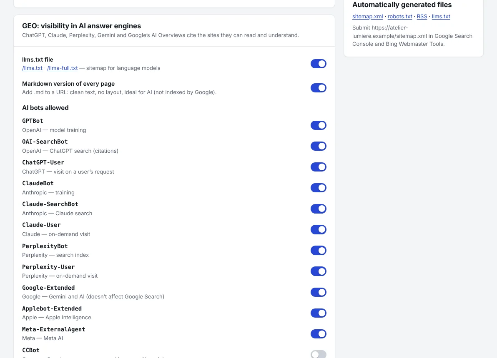

---

## Visual page builder

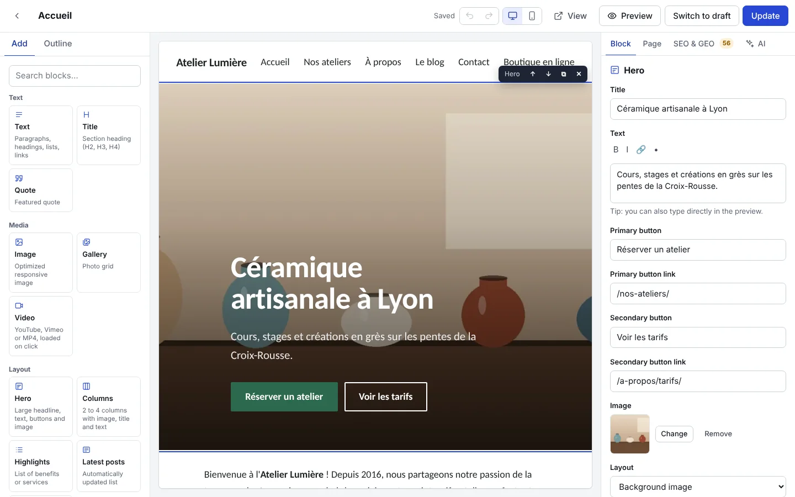

You edit **the page exactly as it will look**, with the site's real design: click any text to type. The settings of the selected block appear on the right.

**22 blocks, designed to convert and to rank:**

| Family | Blocks |
|---|---|
| Text | Text, Title, Quote |
| Media | Image, Gallery, Video (YouTube, Vimeo or file, loaded on click) |
| Layout | Hero, Columns, Highlights, Latest posts, Separator |
| Conversion | Call to action, Testimonials, Pricing, Key figures, Button, Contact form (built-in anti-spam) |
| SEO & AI | FAQ, Key takeaways, Steps, Table of contents |
| Advanced | HTML code (administrators) |

**Editing comfort:** drag and drop in the outline, **undo / redo** (Ctrl+Z, Ctrl+Shift+Z), revisions you can restore, a local draft kept if the connection drops, ready-to-fill page templates, desktop and mobile preview, scheduled publishing, quick search everywhere (Ctrl+K).

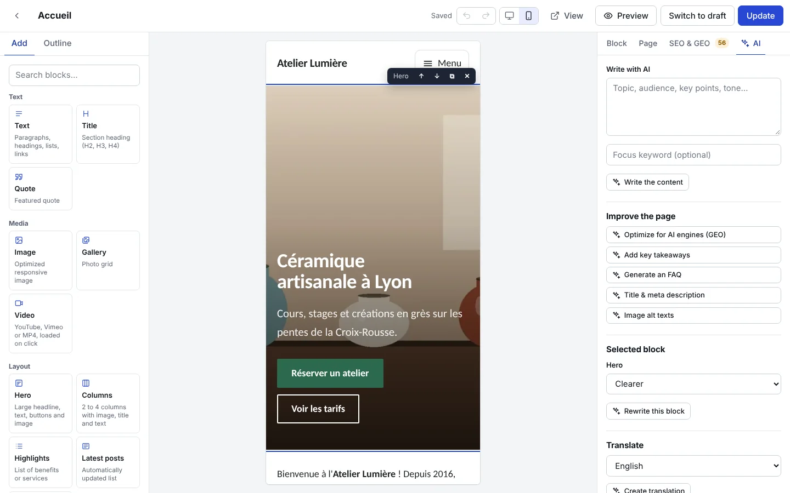

---

## AI assistant to write and optimize

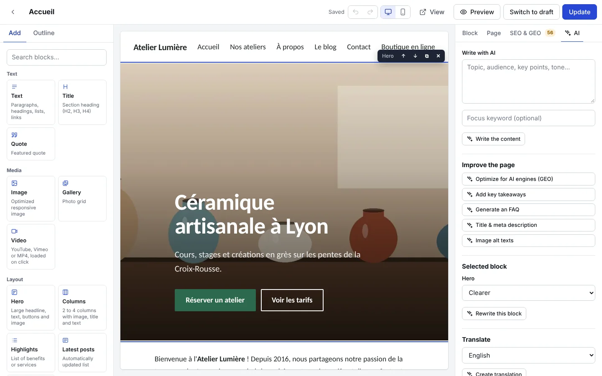

Paste your **Claude** (Anthropic) or **OpenAI** key in the admin: the assistant appears in the editor. It writes for Google **and** for AI answer engines.

| Action | What it does |
|---|---|
| **Write content** | From a topic and a keyword, creates a complete draft: a direct answer up front, question-style subheadings, “Key takeaways”, an FAQ, a title and a meta description. You review before publishing. |
| **Optimize for AI (GEO)** | Restructures an existing page so it is easier to quote. |
| **Key takeaways** | Adds a bullet summary at the top. |
| **FAQ** | Generates questions and answers tagged as structured data. |
| **Title and meta description** | Suggests an SEO title and a description that make people click. |
| **Alt text** | Describes your images using vision (accessibility and Google Images). |
| **Rewrite a block** | Clearer, shorter, longer, warmer, more professional, or proofread. |
| **Translate** | Creates a translated draft linked to the original: French, English, Spanish, German, Italian, Portuguese. |

- **Your brand voice** is applied to every generated text.
- **Models**: Claude Opus 5.5 by default (Sonnet 5.5, Haiku 5.5 and Fable 5.1 available); with OpenAI, Wordless automatically picks the newest model available to your key.
- **Your keys are encrypted** in the database and never shown again. Content is sent to the provider only when you run an action. Usage over the last 30 days is displayed.
- **A cautious brief**: the AI is instructed not to invent figures or sources and to flag what still needs checking.

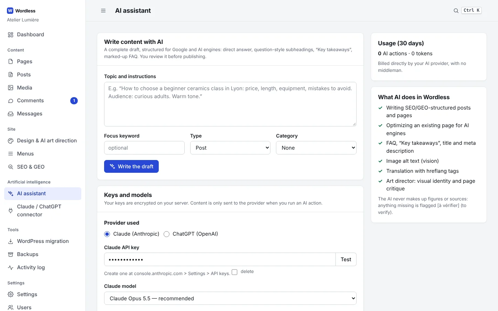

---

## AI art director

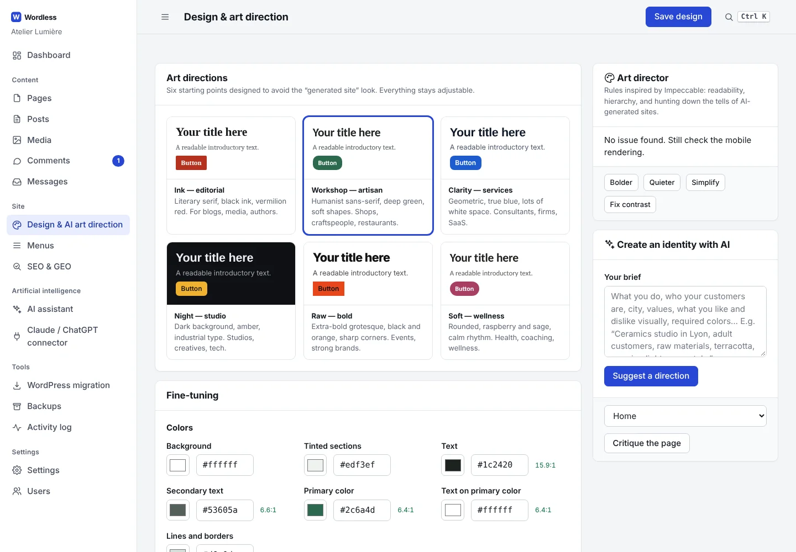

Design is not left to chance. The art director builds on the principles and rules of **[Impeccable](https://github.com/pbakaus/impeccable)** by Paul Bakaus (Apache 2.0 license), adapted to Wordless.

- **6 ready-made art directions**: Ink (editorial), Workshop (craft), Clarity (services), Night (studio), Raw (bold), Soft (wellness).
- **An identity created by AI** from a description of your business: palette, fonts, type scale, rhythm, with WCAG AA contrast guaranteed.
- **A continuous audit**: insufficient contrast (with a suggested fix), flat type hierarchy, text too small, lines too long, and the visual tics of mass-produced sites (purple gradients, cream backgrounds, overused fonts, identical card grids, hero metrics).
- **One-click commands**: *Bolder*, *Quieter*, *Simplify*, *Fix contrast*.
- **A page critique** based on Nielsen's usability heuristics, with prioritized fixes.

---

## MCP connector: Claude and ChatGPT at the controls

<picture>
  <source media="(prefers-color-scheme: dark)" srcset=".github/assets/mcp-en-dark.svg">
  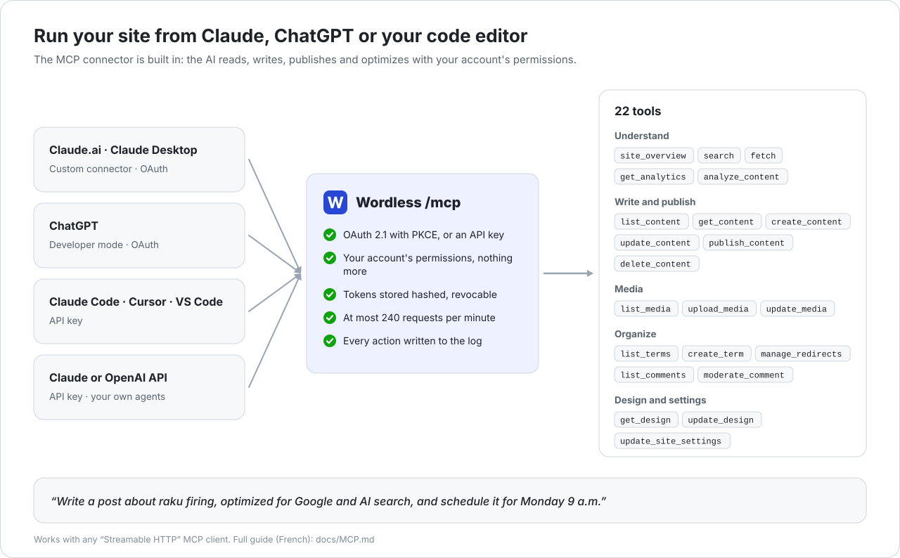
</picture>

Wordless includes an **MCP** server (Model Context Protocol, the open standard that connects AI assistants to tools). Your usual assistant can act on the site when you ask:

- *“Give me a weekly update on the site: visits, pages to improve, comments waiting.”*
- *“Write a post about raku firing, optimized for Google and AI search, and schedule it for Monday 9 a.m.”*
- *“Add an FAQ and alt text to the Pricing page, then show me the GEO score.”*
- *“Create a redirect from /old-course to /summer-throwing-course.”*

**Connecting:**

| Client | How |
|---|---|
| Claude.ai, Claude Desktop | Settings › Connectors › Add custom connector, URL `https://your-site.com/mcp`, then authorize in Wordless (OAuth). |
| ChatGPT | Settings › Apps & Connectors › developer mode › Create, same URL, OAuth. |
| Claude Code | `claude mcp add --transport http wordless https://your-site.com/mcp --header "Authorization: Bearer wl_…"` |
| Cursor, VS Code, others | An API key created in the admin, added to the tool's MCP configuration. |

**Connector security:** OAuth 2.1 with mandatory PKCE and dynamic client registration, dedicated API keys, tokens stored hashed and revocable, permissions limited to those of the authorizing account, at most 240 requests per minute, every action written to the activity log, HTML coming from the AI always sanitized. Full guide (in French): [docs/MCP.md](docs/MCP.md).

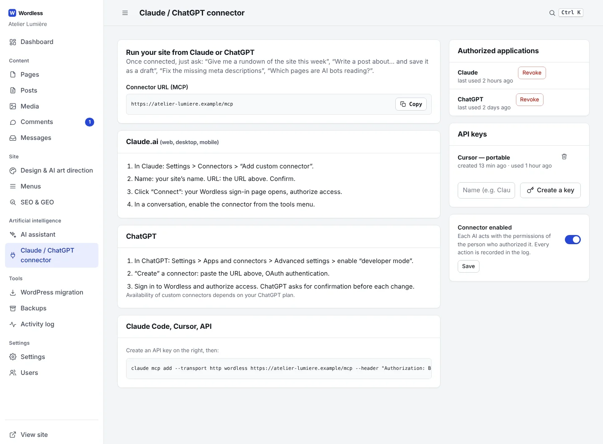

---

## Migrate from WordPress

<picture>
  <source media="(prefers-color-scheme: dark)" srcset=".github/assets/migration-en-dark.svg">
  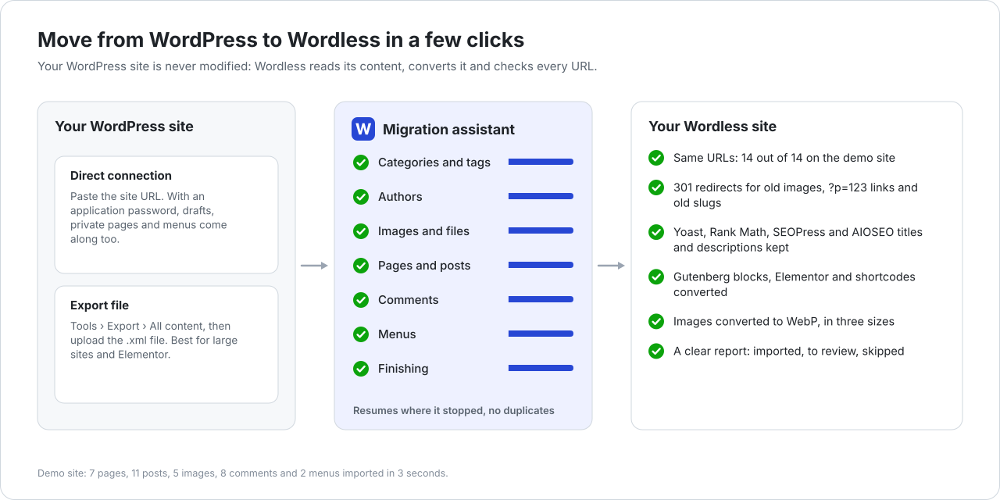
</picture>

**Three steps:**

1. **Install Wordless** on your hosting (see [Installation](#installation)). During setup, check “I already have a WordPress site: I want to migrate it right after”.
2. **Open Tools › WordPress migration** and choose:
   - **the direct connection**: paste your site's URL. Add a WordPress application password to also bring drafts, private pages and menus;
   - **or the export file**: in WordPress, *Tools › Export › All content*. This is the most complete method (Elementor layouts, plugin metadata).
3. **Check the report**, then point your domain name to Wordless.

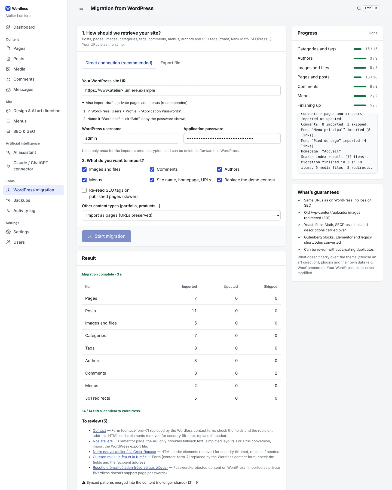

**What is carried over:**

| Item | Details |
|---|---|
| Pages, posts, other types | Statuses kept (published, draft, scheduled, private), dates, authors, featured image, page hierarchy. |
| Layout | Gutenberg blocks (including Yoast and Rank Math FAQs) and Elementor layouts converted to Wordless blocks; shortcodes interpreted; Divi, WPBakery or Avada content kept with a simplified layout; Contact Form 7 forms replaced by the built-in form. |
| SEO | Titles, descriptions, keywords, noindex, canonical URLs and share images from Yoast SEO, Rank Math, SEOPress, All in One SEO and The SEO Framework. |
| Images and files | Downloaded, converted to WebP in 3 sizes, links rewritten in the content. |
| URLs | **Identical**. Automatic 301 redirects for old image URLs (`/wp-content/uploads/…`, including `-300x200` and `-scaled` variants), `?p=123` links, attachment pages and old slugs. |
| Everything else | Categories, tags, comments (threads up to 3 levels), menus and their locations, authors, site name, home page, permalink structure, time zone. |

**Reliability:** your WordPress site is never modified; the migration resumes where it stopped if interrupted; running it again creates no duplicates; a report lists everything imported, skipped or worth a second look. The demo site (7 pages, 11 posts, 5 images, 8 comments, 2 menus) migrated in 3 seconds, with 14 out of 14 URLs identical. The module is covered by 305 automated checks. Detailed guide (in French): [docs/MIGRATION.md](docs/MIGRATION.md).

---

## 360° dashboard

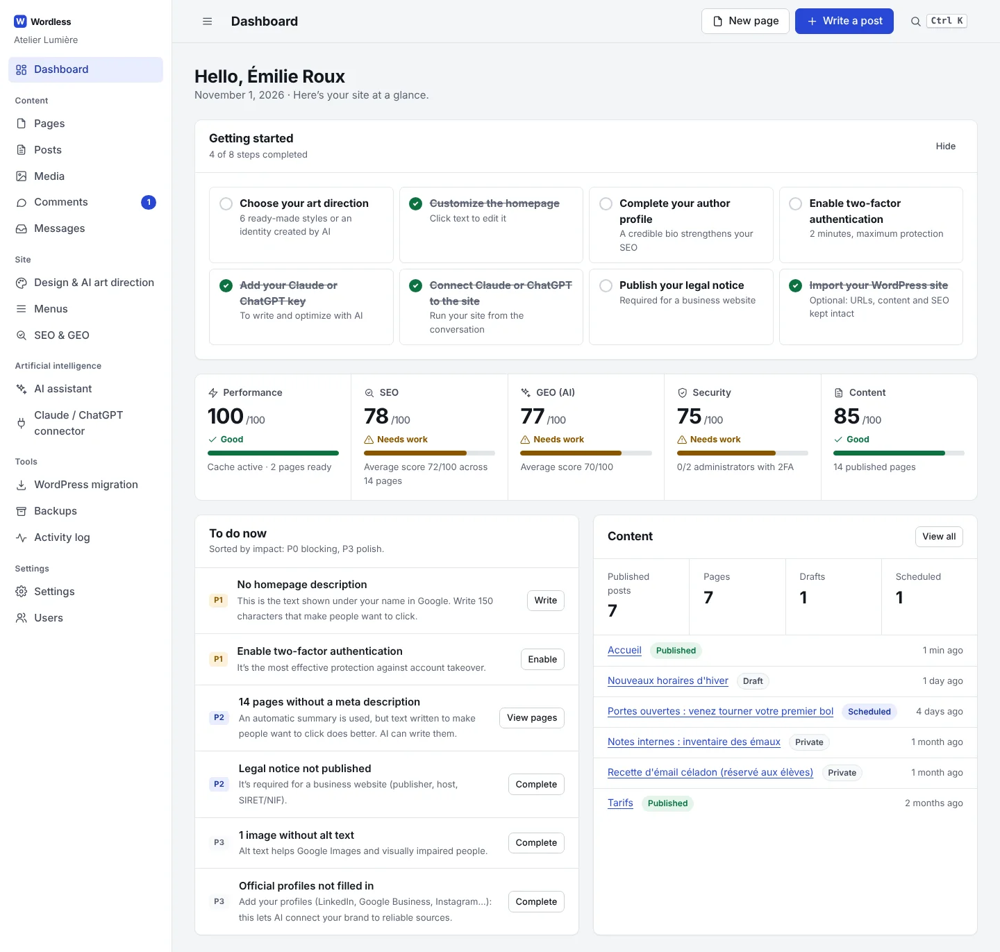

As soon as you sign in, you know where your site stands and what to do next:

- **Getting started**: the key setup steps, ticked off as you go.
- **Site health across 5 pillars**: performance, SEO, GEO, security, content, each scored out of 100 with an explanation.
- **To do now**: actions ranked by impact (P0 blocking to P3 polish), with the button that takes you there.
- **Content**: published, drafts, scheduled, and the latest changes.

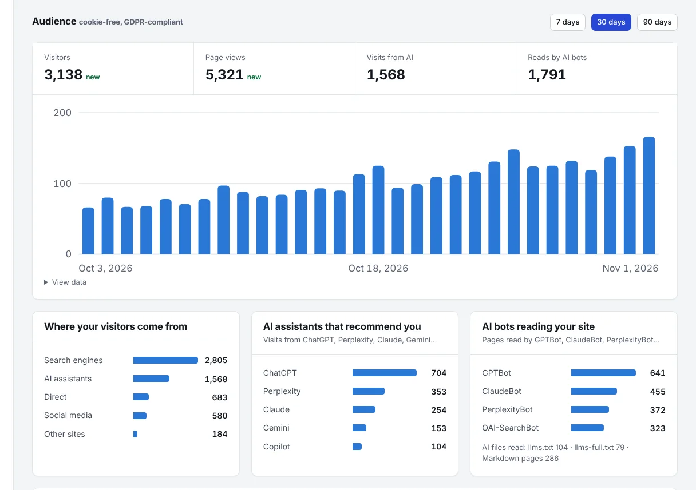

- **Audience with no cookie and no banner**: visitors and page views over 7, 30 or 90 days. The visit identifier is a hash that changes every day: nobody can be followed from one day to the next, and no personal data is kept.
- **Where visitors come from**: search engines, AI assistants, social networks, other sites, direct.
- **The AI assistants that recommend you** (ChatGPT, Perplexity, Claude, Gemini, Copilot) and **the AI crawlers that read your site**, including reads of `llms.txt` and Markdown pages.
- **Most viewed pages**, **recent activity** (who did what, including the connected AI) and **content to refresh**.

*Screenshots taken on the demo site, with demo traffic data.*

---

## Security

<picture>
  <source media="(prefers-color-scheme: dark)" srcset=".github/assets/security-en-dark.svg">
  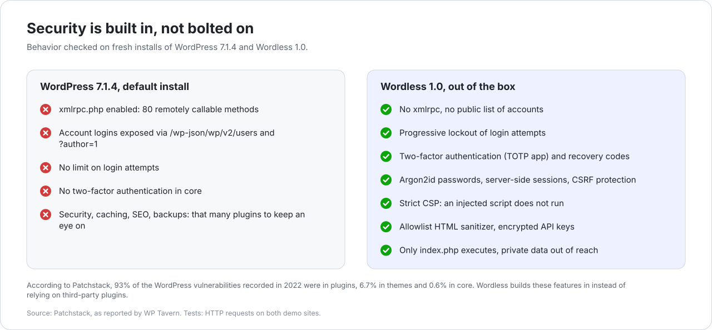
</picture>

The WordPress behavior above was checked on a fresh install of version 7.1.4. So was Wordless's: `xmlrpc.php` and the accounts API do not exist, `?author=1` reveals nothing, and sign-in locks after 6 failed attempts (15 minutes, doubled for repeat offenders).

**What Wordless builds in:**

- **Sign-in**: Argon2id passwords, constant-time checks, progressive lockout per address and per account, **two-factor authentication** with an authenticator app (Google Authenticator, Microsoft Authenticator, 1Password…) and recovery codes, an option to make 2FA mandatory for administrators.
- **Sessions**: stored in the database, random cookie, sign out of every device, CSRF protection on every action.
- **Browser**: strict Content Security Policy on the public site, with the hash of the only allowed style; security headers (framing protection, no sniffing, referrer policy, camera, microphone and geolocation disabled, optional HSTS).
- **Content**: allowlist HTML sanitizer, including for HTML produced by the AI or imported from WordPress; iframes limited to YouTube and Vimeo.
- **Server**: only `index.php` executes; the `data/` and `core/` folders are unreachable from the web; no executable script in `media/`.
- **Data**: AI keys, SMTP passwords and WordPress credentials encrypted (libsodium, or AES-GCM as a fallback); SSRF protection against requests to the internal network; automatic daily backup (14 kept).

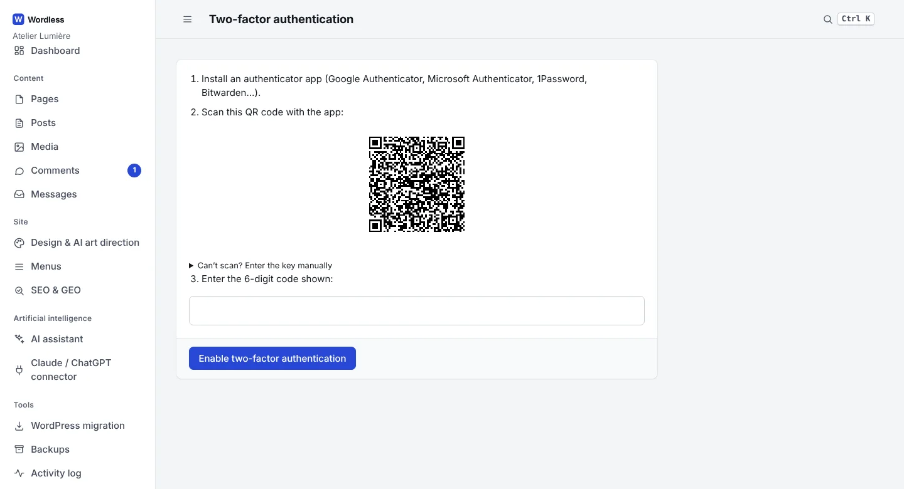

---

## Installation

**Requirements:** PHP 8.1 or later with `pdo_sqlite`, `mbstring`, `dom` and `xml` (available at most hosts). Recommended: `gd` (WebP), `curl` (AI, migration), `intl`, `sodium`, `zip`. The installer checks everything and tells you what is missing.

### On shared hosting (FTP)

1. [Download Wordless](https://github.com/Jacckisback/Wordless/raw/main/dist/wordless-1.0.0.zip) (606 KB) and unzip the archive.
2. Upload the contents of the `wordless/` folder to your site's root over FTP.
3. Open your site's address: enter the site name, your email and a password. **That's it**: the database creates itself.

### From the command line

```bash
php bin/wordless install --url=https://example.com --email=you@example.com --password="A long passphrase" --site="My site" --lang=en
```

To try it locally: `php -S 127.0.0.1:8080 router.php`

### Web server

**Apache and LiteSpeed**: the bundled `.htaccess` handles everything (rewrites, private folder protection, static file caching, compression).

<details>
<summary><b>Nginx</b>: sample configuration</summary>

```nginx
server {
    server_name example.com;
    root /var/www/wordless;
    index index.php;

    # Private folders and hidden files (except .well-known)
    location ~ ^/(data|core|tests|bin)(/|$) { return 403; }
    location ~ /\.(?!well-known/) { return 403; }

    # Media: never PHP, long cache
    location ^~ /media/ {
        location ~ \.php$ { return 403; }
        expires 1y;
        add_header Cache-Control "public, immutable";
        try_files $uri =404;
    }

    # Only index.php executes
    location = /index.php {
        include fastcgi_params;
        fastcgi_param SCRIPT_FILENAME $document_root/index.php;
        fastcgi_param HTTP_AUTHORIZATION $http_authorization;
        fastcgi_pass unix:/run/php/php8.3-fpm.sock;
    }
    location ~ \.php$ { return 403; }

    location / { try_files $uri /index.php$is_args$args; }
}
```
</details>

### Command line

```bash
php bin/wordless help                          # every command
php bin/wordless backup --full                 # database + media backup (zip)
php bin/wordless cache:clear                   # clear the page cache
php bin/wordless import:wxr export.xml         # migrate a WordPress export file
php bin/wordless import:wp https://site.com    # migrate through a WordPress site's API
php bin/wordless mcp:key <email> --label="Claude Code"    # API key for an MCP client
php bin/wordless user:password <email> <password>
php bin/wordless user:2fa-reset <email>        # lost phone
```

### Updates, backups, moving

- Background tasks (scheduled posts, backups, cleanup) run on their own during visits. A cron job `*/10 * * * * php bin/wordless cron` is possible for very quiet sites.
- **Updating**: replace `index.php`, `router.php`, `.htaccess`, `core/`, `admin/` and `themes/default/`, without touching `data/` or `media/`. The database upgrades itself.
- **Moving**: your whole site fits in two folders, `data/` (database, settings, backups) and `media/` (files).

---

## For developers

- **Zero dependencies**: plain PHP 8.1+, no Composer, no framework, no build step. Autoloading maps `Wordless\Class` to `core/Class.php`.
- **SQLite** (WAL mode) with FTS5 full-text search and automatic schema migrations.
- **Architecture**: single entry point, fast cache served before the application, router, PHP views, a theme made of PHP templates with minified inline CSS. Details (in French): [docs/ARCHITECTURE.md](docs/ARCHITECTURE.md).
- **Plugins**: actions and filters (`wl_on`, `wl_filter`, `wl_do`), enabled from the command line. See [plugins/README.md](plugins/README.md).
- **Tests**: `php tests/migrate_test.php` (305 checks, against a real WordPress test site built by `tests/wp-fixture/build.sh`) and `php tests/mcp_test.php` (213 checks).
- **Translations**: source strings are in French; `php bin/i18n-missing.php` lists what is missing in `core/lang/en.php` and `core/lang/es.php`.
- **Install archive**: `php bin/build-dist.php`.
- **Diagrams in this README**: `python3 .github/assets/src/make_diagrams.py` (figures in `metrics.json`).

---

## FAQ

<details>
<summary><b>Is Wordless free?</b></summary>

Yes. It is free software under the GNU AGPL-3.0 license: you can use it, including commercially, study it and modify it. If you make a modified version available to others, including online as a hosted service, you must publish its source code under the same license. AI usage is billed directly by your provider (Anthropic or OpenAI), based on your consumption.
</details>

<details>
<summary><b>Will I lose my rankings when leaving WordPress?</b></summary>

That is exactly what the migration tool is for: your page URLs stay the same, old URL forms are redirected with a 301, and the titles and descriptions from your SEO plugin are carried over. After the switch, submit your sitemap (`/sitemap.xml`) in Google Search Console and watch the 404 log for a few days.
</details>

<details>
<summary><b>Will my WordPress plugins work?</b></summary>

No: Wordless does not run WordPress code. But most of what common plugins do is already built in (see the [equivalence table](#what-wordpress-hands-off-to-plugins-wordless-builds-in)). For a specific need, Wordless accepts lightweight plugins written in PHP.
</details>

<details>
<summary><b>Can I sell online?</b></summary>

Not yet: Wordless has no e-commerce module. WooCommerce products are not imported (the migration report flags them). If your shop is the heart of your business, stay on WordPress or use a dedicated e-commerce solution.
</details>

<details>
<summary><b>What hosting do I need?</b></summary>

Ordinary PHP 8.1 hosting is enough, shared hosting included. No MySQL database to create: SQLite is built into PHP. Since pages are served from the cache, most visits never touch the application or the database.
</details>

<details>
<summary><b>Is my content sent to the AI?</b></summary>

Only when you run an AI action, and only the content involved, to the provider whose key you entered. Nothing is sent in the background. The MCP connector only acts when your assistant calls it, with the permissions of the account that authorized it, and every action is logged.
</details>

<details>
<summary><b>Can the site be multilingual?</b></summary>

The admin is available in French, English and Spanish. For content, the AI assistant creates translations (French, English, Spanish, German, Italian, Portuguese) as drafts linked to the original, to be reviewed before publishing.
</details>

---

## Known limitations

Wordless 1.0 is young. To decide with full knowledge:

- **No e-commerce and no multisite**; no plugin ecosystem comparable to WordPress's.
- **Not carried over by the migration**: WooCommerce products, ACF fields, custom taxonomies (flagged in the report); password-protected content becomes private.
- **Admin interface** in three languages (French, English, Spanish).
- **MCP connector**: OAuth sign-in expects Wordless at the domain root (a redirect is enough otherwise); clients with a custom callback scheme (`cursor://`…) use an API key.
- **The measurements** were taken on PHP's built-in server: on your hosting the absolute values will change, the gaps will stay of the same order.

---

## License and credits

Copyright © 2026 Thierry Gustin.

Wordless is free software: you can redistribute it and/or modify it under the terms of the **GNU Affero General Public License, version 3** (AGPL-3.0-only), as published by the Free Software Foundation. It is distributed without any warranty. Full text: [LICENSE](LICENSE). If you modify Wordless and make it available to others, remember to change the `WL_SOURCE` address in `core/bootstrap.php` so it points to your source code.

The art director adapts the principles and rules of [Impeccable](https://github.com/pbakaus/impeccable) by Paul Bakaus, published under the Apache 2.0 license (see `core/Ai/impeccable/NOTICE`).

Wordless is neither affiliated with nor endorsed by the WordPress Foundation or Automattic. WordPress is a trademark of the WordPress Foundation. Claude is a trademark of Anthropic; ChatGPT is a trademark of OpenAI.
