<p align="center"><b>Français</b> · <a href="README.en.md">English</a></p>

<p align="center">
  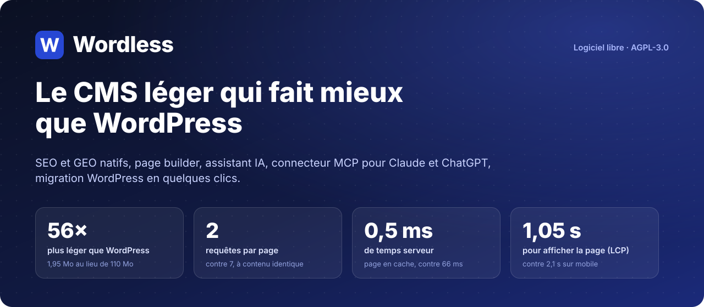
</p>

<p align="center">
  <a href="LICENSE"></a>
  
  
  
  
  
</p>

<p align="center">
  <a href="https://github.com/Jacckisback/Wordless/raw/main/dist/wordless-1.0.1.zip"><b>Télécharger Wordless 1.0.1</b></a> (620 Ko)
  · <a href="#installation">Installer en 3 minutes</a>
  · <a href="#migrer-depuis-wordpress">Migrer depuis WordPress</a>
  · <a href="docs/BENCHMARK.md">Voir les mesures</a>
</p>

---

# Wordless : le CMS léger, rapide et sécurisé, alternative à WordPress

**Wordless est un CMS en PHP qui fait ce que fait WordPress, et ce que WordPress confie à une dizaine d'extensions, dans un logiciel 56 fois plus léger.** Page builder visuel, SEO et GEO natifs (visibilité dans Google *et* dans ChatGPT, Claude, Perplexity), assistant IA, connecteur MCP pour piloter le site depuis Claude ou ChatGPT, sécurité renforcée et tableau de bord complet : tout est inclus et réglé dès l'installation.

Le passage depuis WordPress se fait **en quelques clics**, avec **les mêmes adresses** : vos pages gardent leur référencement, vos liens restent valides.

<p align="center">
  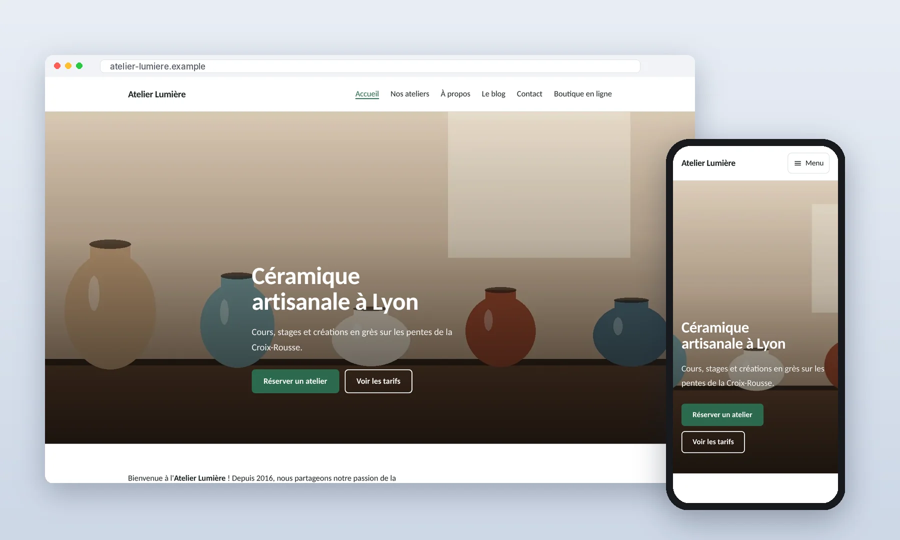
</p>

> **Tous les chiffres de cette page sont mesurés, pas estimés.** Le site WordPress de démonstration « Atelier Lumière » (WordPress 7.1.4, thème par défaut) a été migré vers Wordless avec l'outil intégré, puis les deux versions ont été comparées sur la même machine. Méthode et résultats complets : [docs/BENCHMARK.md](docs/BENCHMARK.md).

## Sommaire

- [En bref](#en-bref)
- [Wordless face à WordPress](#wordless-face-à-wordpress)
- [Vitesse : moins de code, meilleur résultat](#vitesse--moins-de-code-meilleur-résultat)
- [SEO intégré, sans extension](#seo-intégré-sans-extension)
- [GEO : être cité par les IA](#geo--être-cité-par-les-ia)
- [Page builder visuel](#page-builder-visuel)
- [Assistant IA pour rédiger et optimiser](#assistant-ia-pour-rédiger-et-optimiser)
- [Directeur artistique IA](#directeur-artistique-ia)
- [Connecteur MCP : Claude et ChatGPT aux commandes](#connecteur-mcp--claude-et-chatgpt-aux-commandes)
- [Migrer depuis WordPress](#migrer-depuis-wordpress)
- [Tableau de bord à 360°](#tableau-de-bord-à-360)
- [Sécurité](#sécurité)
- [Installation](#installation)
- [Pour les développeurs](#pour-les-développeurs)
- [Questions fréquentes](#questions-fréquentes)
- [Limites connues](#limites-connues)
- [Licence et crédits](#licence-et-crédits)

---

## En bref

| Atout | En pratique |
|---|---|
| **56× plus léger** | 1,95 Mo et 172 fichiers, contre 110 Mo et 3 782 fichiers pour WordPress 7.1.4. |
| **6× moins de données par page** | 42 Ko et 2 requêtes pour l'accueil du site de démonstration, contre 252 Ko et 7 requêtes avec WordPress. |
| **Réponse serveur en 0,5 ms** | Les pages sont servies depuis un cache intégré, sans démarrer l'application ni interroger la base. |
| **Affichage 2× plus rapide** | LCP mobile de 1,05 s contre 2,10 s (Lighthouse 13.6), Lighthouse SEO 100 contre 92. |
| **SEO et GEO d'origine** | Données structurées, sitemaps, `llms.txt`, version Markdown de chaque page, score SEO et GEO à chaque modification. |
| **IA intégrée** | Rédaction, FAQ, méta-descriptions, textes alternatifs, traduction en 6 langues, directeur artistique, avec votre clé Claude ou OpenAI. |
| **Connecteur MCP** | Claude.ai, ChatGPT, Claude Code ou Cursor lisent, rédigent et publient sur votre site, avec les droits de votre compte. |
| **Migration en quelques clics** | Contenus, images, menus, commentaires, auteurs et réglages SEO repris, mêmes adresses, redirections 301 automatiques. |
| **Aucune dépendance** | PHP 8.1 et SQLite : ni MySQL à créer, ni Composer, ni npm. Fonctionne sur un hébergement mutualisé classique. |

---

## Wordless face à WordPress

<picture>
  <source media="(prefers-color-scheme: dark)" srcset=".github/assets/bench-fr-dark.svg">
  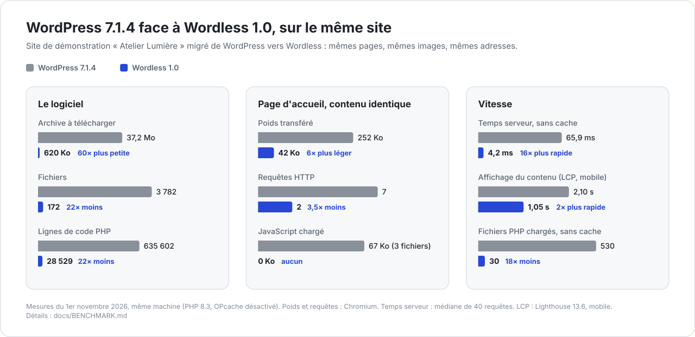
</picture>

### Les chiffres, sur le même site

Le site « Atelier Lumière » (7 pages, 11 articles, 5 images, menus, commentaires) a été construit sous WordPress 7.1.4 avec son thème par défaut, puis migré vers Wordless avec l'outil intégré. Mêmes contenus, mêmes images, mêmes adresses. Le poids du logiciel est celui de la version 1.0.1 ; les mesures de performance ont été faites avec la 1.0.0, qui produit les mêmes pages (la 1.0.1 ajoute seulement le résumé « L'essentiel » aux données structurées).

| Mesure | WordPress 7.1.4 | Wordless 1.0 | Écart |
|---|---:|---:|---:|
| Archive à télécharger | 37,2 Mo | 620 Ko | 60× plus petite |
| Taille installée | 110,1 Mo | 1,95 Mo | 56× plus léger |
| Nombre de fichiers | 3 782 | 172 | 22× moins |
| Lignes de code PHP | 635 602 | 28 529 | 22× moins |
| Poids de la page d'accueil | 252 Ko | 42 Ko | 6× plus léger |
| Requêtes pour afficher l'accueil | 7 | 2 | 3,5× moins |
| JavaScript chargé sur l'accueil | 67 Ko (3 fichiers) | 0 | aucun |
| Police web téléchargée | 52 Ko | 0 | polices système |
| Poids d'un article | 346 Ko (11 requêtes) | 54 Ko (3 requêtes) | 6,4× plus léger |
| Temps serveur, page en cache | pas de cache d'origine | 0,5 ms | |
| Temps serveur, sans cache | 65,9 ms | 4,2 ms | 16× plus rapide |
| Fichiers PHP chargés par page | 530 | 4 en cache, 30 sans cache | |
| Requêtes SQL par page | 32 | 0 en cache, 24 sans cache | |
| Mémoire PHP par page | 10 Mo | 2 Mo | 5× moins |

### Lighthouse, mobile (médiane de 3 passages)

| | WordPress, accueil | Wordless, accueil | WordPress, article | Wordless, article |
|---|:---:|:---:|:---:|:---:|
| Performance | 99 | **100** | 99 | **100** |
| Accessibilité | 98 | 98 | 100 | 100 |
| Bonnes pratiques | 100 | 100 | 100 | 100 |
| SEO | 92 | **100** | 92 | **100** |
| First Contentful Paint | 1,20 s | **0,85 s** | 1,35 s | **0,87 s** |
| Largest Contentful Paint | 2,10 s | **1,05 s** | 2,01 s | **1,05 s** |

WordPress obtient déjà un bon score de performance avec son thème par défaut : l'écart se joue sur le temps d'affichage réel (le LCP est divisé par deux), sur le poids et sur le travail du serveur. Le SEO passe de 92 à 100 parce que Wordless écrit une méta-description dès la publication, ce que WordPress ne fait pas sans extension.

<details>
<summary><b>Conditions de mesure</b></summary>

Même machine, PHP 8.3.6, serveur intégré de PHP, OPcache désactivé pour les deux. WordPress fonctionne avec l'extension officielle *SQLite Database Integration* (aucun serveur MySQL dans l'environnement de test). Poids et requêtes mesurés dans Chromium, temps serveur en médiane de 40 requêtes, scores avec Lighthouse 13.6 en mode mobile. Avec MySQL et OPcache, WordPress répond plus vite qu'ici, et Wordless aussi : l'ordre de grandeur reste. Détails et commandes pour refaire la mesure : [docs/BENCHMARK.md](docs/BENCHMARK.md).
</details>

### Ce que WordPress délègue à des extensions, Wordless l'intègre

| Besoin | WordPress 7.1.4 (cœur) | Extension souvent ajoutée | Wordless 1.0 |
|---|---|---|---|
| Méta-descriptions, titres SEO, analyse | non | Yoast SEO, Rank Math | intégré, score en direct |
| Données structurées (JSON-LD) | non | Yoast SEO, Rank Math, Schema Pro | intégré : article, FAQ, guide pratique, vidéo, fil d'Ariane, organisation |
| Plan du site XML | oui, sans images | Yoast SEO, Rank Math | intégré, avec images |
| `llms.txt`, version Markdown des pages | non | extensions spécialisées | intégré |
| Choix des robots d'IA autorisés | non | réglage manuel de robots.txt | intégré, robot par robot |
| Cache de pages | non | WP Rocket, W3 Total Cache | intégré, actif par défaut |
| Images WebP en plusieurs tailles | tailles multiples, conversion WebP non | Imagify, EWWW | intégré |
| Page builder | éditeur de blocs Gutenberg | Elementor, Divi | intégré, édition directe dans la page |
| Redirections 301 et pages introuvables | anciens slugs d'articles seulement | Redirection | intégré : redirections, journal des 404, suggestions |
| Double authentification | non | Wordfence, Two Factor | intégré (TOTP + codes de secours) |
| Limite des tentatives de connexion | non | Limit Login Attempts, Wordfence | intégré, blocage progressif |
| Statistiques de visite | non | Site Kit, MonsterInsights (+ bandeau cookies) | intégré, sans cookie |
| Sauvegardes | non | UpdraftPlus | intégré, quotidiennes |
| Assistant de rédaction IA | API IA pour les développeurs, écran « Connecteurs » | AI Engine, extensions IA | intégré, prêt à l'emploi |
| Serveur MCP | non | extension MCP Adapter | intégré, OAuth 2.1 |
| Formulaire de contact | non | Contact Form 7, WPForms | intégré, anti-spam |

Chaque extension ajoute du code exécuté à chaque visite, des mises à jour à surveiller et une surface d'attaque. Selon Patchstack, **93 % des failles WordPress recensées en 2022 venaient des extensions**, 6,7 % des thèmes et 0,6 % du cœur ([source](https://wptavern.com/patchstack-tracks-328-more-security-bugs-reported-in-wordpress-plugins-in-2022)).

> **Ce que WordPress fait mieux, honnêtement.** Un écosystème de dizaines de milliers d'extensions et de thèmes, l'e-commerce avec WooCommerce, le multisite, une traduction de l'interface dans des dizaines de langues et une immense communauté. Si votre site dépend de ces fonctions, gardez WordPress. Wordless vise les sites vitrines, blogs, sites d'experts, d'artisans et de PME, qui veulent vitesse, référencement et simplicité sans maintenir une pile d'extensions.

---

## Vitesse : moins de code, meilleur résultat

<picture>
  <source media="(prefers-color-scheme: dark)" srcset=".github/assets/flow-fr-dark.svg">
  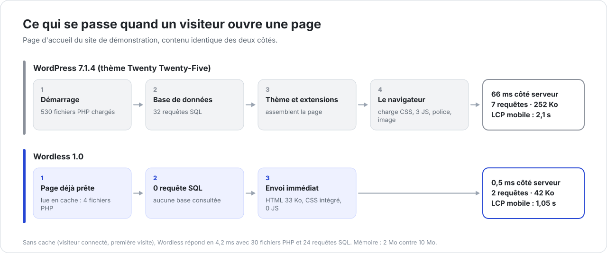
</picture>

Un site plus léger n'est pas un site qui en fait moins : c'est un site qui ne fait **que** ce qui est utile au visiteur.

- **Cache servi avant l'application.** Pour un visiteur, Wordless lit la page déjà calculée et l'envoie : 4 fichiers PHP, aucune requête SQL, 0,5 ms. Le cache se met à jour tout seul quand vous publiez ou modifiez un contenu.
- **Zéro JavaScript sur le site public.** Le menu mobile fonctionne en HTML natif. Seules les pages qui contiennent une vidéo chargent un script de moins de 1 Ko, et le lecteur YouTube ou Vimeo ne se charge qu'au clic du visiteur.
- **CSS intégré à la page.** Une seule requête suffit pour afficher la page, sans fichier CSS qui bloque le rendu. Son empreinte est autorisée par une politique de sécurité stricte.
- **Images optimisées automatiquement.** Chaque image envoyée est réorientée, recompressée, convertie en WebP et déclinée en 3 tailles (480, 960 et 1 440 px) ; le navigateur choisit la bonne. Chargement différé sous la ligne de flottaison, priorité à l'image principale.
- **Polices système.** 13 piles de polices soignées, sans téléchargement. Une police Google peut être installée sur votre propre serveur (rien n'est chargé depuis Google, conforme RGPD).
- **SQLite en mode WAL.** Une base dans un simple fichier, sans serveur à administrer, rapide en lecture.

**Ce que ça change :** de meilleurs Core Web Vitals (facteur de classement Google), des visiteurs mobiles qui restent, un hébergement modeste qui suffit, et moins de données transférées à chaque visite.

---

## SEO intégré, sans extension


Chaque page est analysée pendant que vous écrivez. L'onglet **SEO & GEO** montre l'aperçu Google, deux scores sur 100 et des conseils concrets, classés par importance.

**Ce que Wordless fait pour vous, sans réglage :**

- **Balises** : titre SEO avec modèle (`{titre} – {site}`), méta-description (rédigée par vous, par l'IA ou générée automatiquement), URL canonique, Open Graph et cartes Twitter/X, image de partage par défaut.
- **Données structurées JSON-LD** : organisation ou personne, site avec moteur de recherche interne, page, fil d'Ariane, article (BlogPosting, Article, NewsArticle), FAQ, guide pratique (HowTo), vidéo, image ; le bloc « L'essentiel » devient le résumé de la page (`abstract`) et la partie à lire à voix haute (`speakable`).
- **Plans du site XML** par type de contenu, avec les images, déclarés dans `robots.txt`. **IndexNow** prévient Bing, Yandex et Seznam à chaque publication.
- **Adresses propres** et configurables (`/{slug}`, `/{year}/{month}/{slug}`, `/{category}/{slug}`…), barre finale au choix.
- **Redirections 301 automatiques** quand une adresse change (y compris pour les pages enfants), gestionnaire de redirections avec import CSV, **journal des pages introuvables** avec suggestion de la page la plus proche.
- **Vérification Google Search Console, Bing, Yandex** par simple collage du code.

**L'analyse SEO vérifie :** longueur du titre et de la méta-description, titres H2 et ordre des niveaux, textes alternatifs des images, liens internes, image à la une, longueur de l'adresse, présence du mot-clé principal (titre, description, introduction, sous-titres, adresse) sans excès, lisibilité, titres en double, pages exclues de Google.

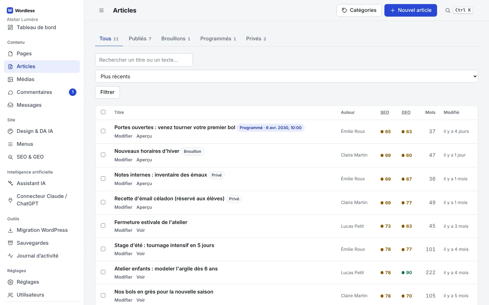

---

## GEO : être cité par les IA

<picture>
  <source media="(prefers-color-scheme: dark)" srcset=".github/assets/geo-fr-dark.svg">
  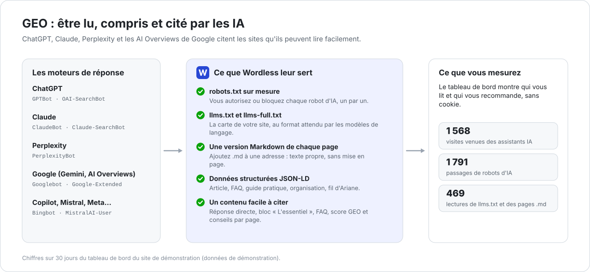
</picture>

Le **GEO** (Generative Engine Optimization) consiste à être lu, compris et **cité** par les moteurs de réponse : ChatGPT, Claude, Perplexity, Gemini, Copilot et les AI Overviews de Google. Une part croissante des recherches s'arrête à leur réponse ; être la source citée devient aussi important qu'être premier sur Google.

**Wordless le prend en charge d'origine :**

- **`/llms.txt` et `/llms-full.txt`**, la carte de votre site au format proposé pour les modèles de langage.
- **Une version Markdown de chaque page** : ajoutez `.md` à n'importe quelle adresse (`/mon-article.md`) pour obtenir le texte propre, sans mise en page. Ces versions ne sont pas indexées par Google (pas de contenu dupliqué).
- **Le choix des robots d'IA**, un par un : GPTBot, OAI-SearchBot, ChatGPT-User, ClaudeBot, Claude-SearchBot, Claude-User, PerplexityBot, Perplexity-User, Google-Extended, Applebot-Extended, Meta-ExternalAgent, CCBot… Vous décidez qui peut entraîner ses modèles sur votre contenu et qui peut le citer.
- **Des blocs pensés pour être repris** : « L'essentiel » (résumé en points clés, repris dans les données structurées), FAQ balisée, étapes (HowTo), sommaire.
- **Un score GEO sur 100 pour chaque page**, qui vérifie : réponse directe en introduction (40 à 60 mots), sous-titres formulés comme des questions, FAQ d'au moins 3 questions, listes, tableaux et étapes, chiffres datés, sources citées avec un lien, citation d'expert ou de client, auteur identifié avec biographie (E-E-A-T), fraîcheur du contenu, robots d'IA autorisés.
- **La mesure** : le tableau de bord compte les visites venues des assistants IA, les passages des robots d'IA et les lectures de `llms.txt` et des pages `.md`.

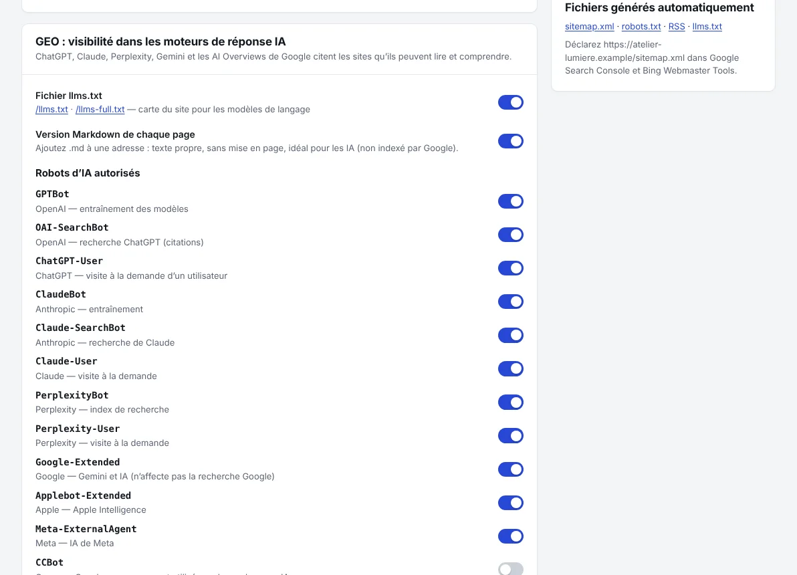

---

## Page builder visuel


Vous modifiez **directement la page telle qu'elle apparaîtra**, avec le vrai design du site : un clic sur un texte suffit pour l'écrire. Les réglages du bloc sélectionné s'affichent à droite.

**22 blocs, pensés pour convertir et pour être bien référencés :**

| Famille | Blocs |
|---|---|
| Texte | Texte, Titre, Citation |
| Médias | Image, Galerie, Vidéo (YouTube, Vimeo ou fichier, chargée au clic) |
| Mise en page | Bannière, Colonnes, Points forts, Derniers articles, Séparateur |
| Conversion | Appel à l'action, Témoignages, Tarifs, Chiffres clés, Bouton, Formulaire de contact (anti-spam intégré) |
| SEO & IA | FAQ, L'essentiel, Étapes, Sommaire |
| Avancé | Code HTML (administrateurs) |

**Confort d'édition :** glisser-déposer dans la structure, **annuler / rétablir** (Ctrl+Z, Ctrl+Maj+Z), révisions avec restauration, brouillon sauvegardé localement en cas de coupure, modèles de pages prêts à remplir, aperçu ordinateur et mobile, publication programmée, recherche rapide partout (Ctrl+K).

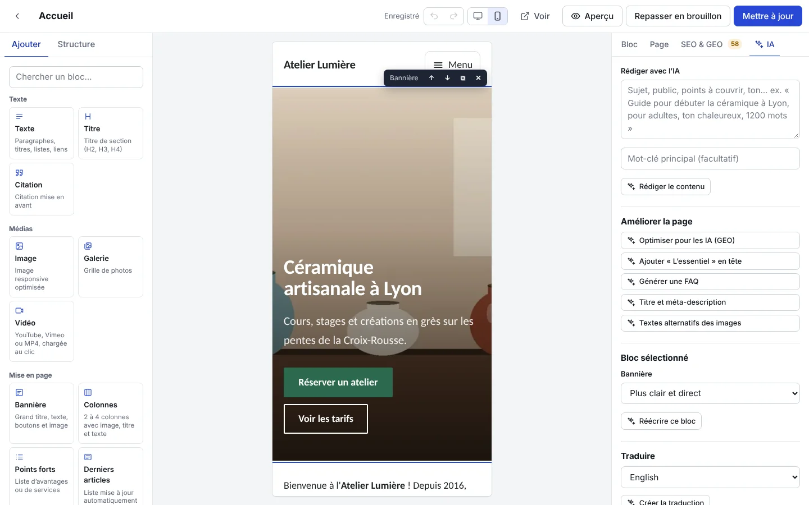

---

## Assistant IA pour rédiger et optimiser


Collez votre clé **Claude** (Anthropic) ou **OpenAI** dans l'administration : l'assistant apparaît dans l'éditeur. Il écrit pour Google **et** pour les moteurs de réponse IA.

| Action | Ce qu'elle fait |
|---|---|
| **Rédiger un contenu** | À partir d'un sujet et d'un mot-clé, crée un brouillon complet : réponse directe en introduction, intertitres en questions, « L'essentiel », FAQ, titre et méta-description. Vous relisez avant de publier. |
| **Optimiser pour les IA (GEO)** | Restructure une page existante pour qu'elle soit plus facile à citer. |
| **L'essentiel** | Ajoute en tête un résumé en points clés. |
| **FAQ** | Génère des questions-réponses balisées en données structurées. |
| **Titre et méta-description** | Propose un titre SEO et une description qui donnent envie de cliquer. |
| **Textes alternatifs** | Décrit vos images grâce à la vision (accessibilité et Google Images). |
| **Réécrire un bloc** | Plus clair, plus court, plus développé, plus chaleureux, plus professionnel ou corrigé. |
| **Traduire** | Crée une version traduite en brouillon, reliée à l'originale : français, anglais, espagnol, allemand, italien, portugais. |

- **Votre voix de marque** est appliquée à tous les textes générés.
- **Modèles** : Claude Opus 5.5 par défaut (Sonnet 5.5, Haiku 5.5 et Fable 5.1 au choix) ; côté OpenAI, Wordless choisit automatiquement le modèle le plus récent disponible pour votre clé.
- **Vos clés sont chiffrées** dans la base et ne sont jamais réaffichées. Le contenu n'est envoyé au fournisseur que lorsque vous lancez une action. La consommation des 30 derniers jours est affichée.
- **Consigne de prudence** : l'IA a pour instruction de ne pas inventer de chiffres ni de sources et de signaler ce qui reste à vérifier.

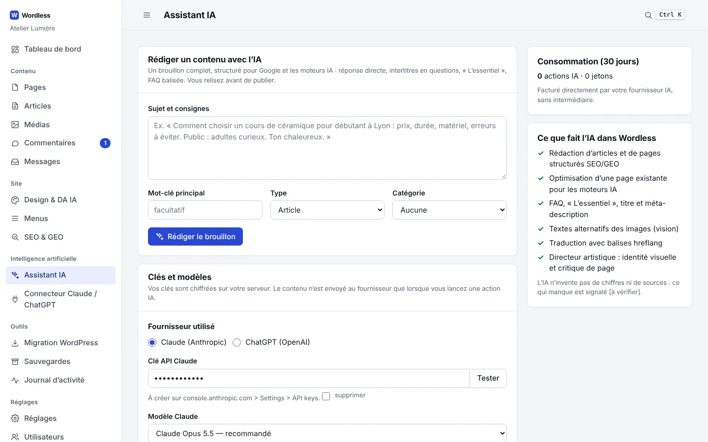

---

## Directeur artistique IA

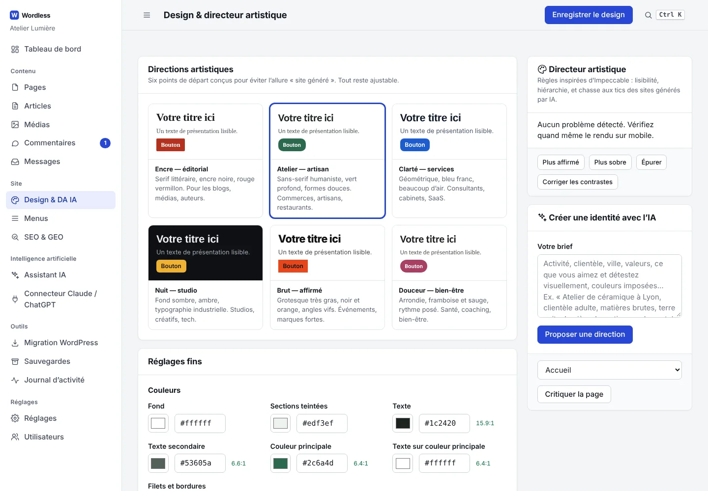

Le design n'est pas laissé au hasard. Le directeur artistique reprend les principes et les règles d'**[Impeccable](https://github.com/pbakaus/impeccable)** de Paul Bakaus (licence Apache 2.0), adaptés à Wordless.

- **6 directions artistiques prêtes** : Encre (éditorial), Atelier (artisan), Clarté (services), Nuit (studio), Brut (affirmé), Douceur (bien-être).
- **Une identité créée par l'IA** à partir d'une description de votre activité : palette, typographies, échelle, rythme, avec contrastes WCAG AA garantis.
- **Un audit permanent** : contrastes insuffisants (avec correction proposée), hiérarchie typographique plate, texte trop petit, lignes trop longues, et les tics visuels des sites générés à la chaîne (dégradés violets, fonds crème, polices surutilisées, grilles de cartes identiques, chiffres héroïques).
- **Des commandes en un clic** : *Plus affirmé*, *Plus sobre*, *Épurer*, *Corriger les contrastes*.
- **Une critique de page** fondée sur les heuristiques d'ergonomie de Nielsen, avec des correctifs priorisés.

---

## Connecteur MCP : Claude et ChatGPT aux commandes

<picture>
  <source media="(prefers-color-scheme: dark)" srcset=".github/assets/mcp-fr-dark.svg">
  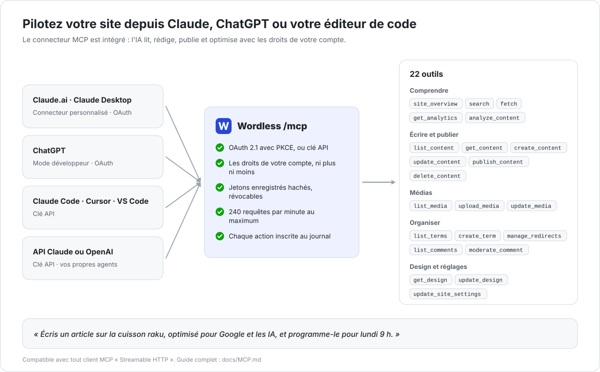
</picture>

Wordless intègre un serveur **MCP** (Model Context Protocol, le standard ouvert qui relie les assistants IA à des outils). Votre assistant habituel devient capable d'agir sur le site, à votre demande :

- *« Fais-moi le point sur le site cette semaine : visites, pages à améliorer, commentaires en attente. »*
- *« Écris un article sur la cuisson raku, optimisé pour Google et les IA, et programme-le pour lundi 9 h. »*
- *« Ajoute une FAQ et des textes alternatifs à la page Tarifs, puis montre-moi le score GEO. »*
- *« Crée une redirection de /ancien-stage vers /stage-ete-tournage-intensif. »*

**Se connecter :**

| Client | Comment |
|---|---|
| Claude.ai, Claude Desktop | Réglages › Connecteurs › Ajouter un connecteur personnalisé, adresse `https://votre-site.fr/mcp`, puis autorisation dans Wordless (OAuth). |
| ChatGPT | Paramètres › Applications et connecteurs › mode développeur › Créer, même adresse, OAuth. |
| Claude Code | `claude mcp add --transport http wordless https://votre-site.fr/mcp --header "Authorization: Bearer wl_…"` |
| Cursor, VS Code, autres | Clé API créée dans l'administration, ajoutée à la configuration MCP de l'outil. |

**Sécurité du connecteur :** OAuth 2.1 avec PKCE obligatoire, inscription dynamique des clients ou fiche d'identité publiée par l'application (« Client ID Metadata Documents » de la spécification MCP), clés API à usage dédié, jetons enregistrés hachés et révocables, droits limités à ceux du compte qui autorise, 240 requêtes par minute au maximum, chaque action inscrite au journal d'activité, HTML reçu de l'IA toujours nettoyé. Guide complet : [docs/MCP.md](docs/MCP.md).

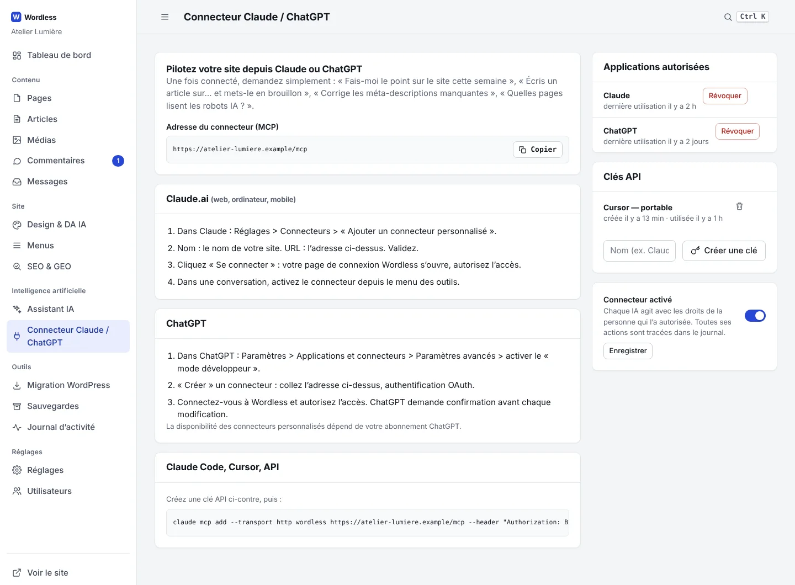

---

## Migrer depuis WordPress

<picture>
  <source media="(prefers-color-scheme: dark)" srcset=".github/assets/migration-fr-dark.svg">
  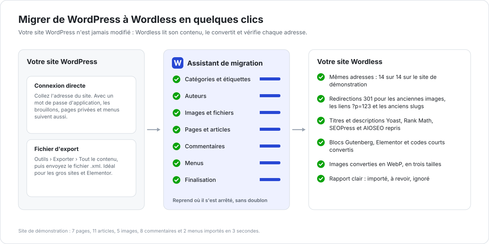
</picture>

**Trois étapes :**

1. **Installez Wordless** sur votre hébergement (voir [Installation](#installation)). À l'installation, cochez « J'ai déjà un site WordPress : je veux le migrer juste après ».
2. **Ouvrez Outils › Migration WordPress** et choisissez :
   - **la connexion directe** : collez l'adresse de votre site. Ajoutez un mot de passe d'application WordPress pour reprendre aussi les brouillons, pages privées et menus ;
   - **ou le fichier d'export** : dans WordPress, *Outils › Exporter › Tout le contenu*. C'est la méthode la plus complète (mises en page Elementor, métadonnées des extensions).
3. **Vérifiez le rapport**, puis faites pointer votre nom de domaine vers Wordless.

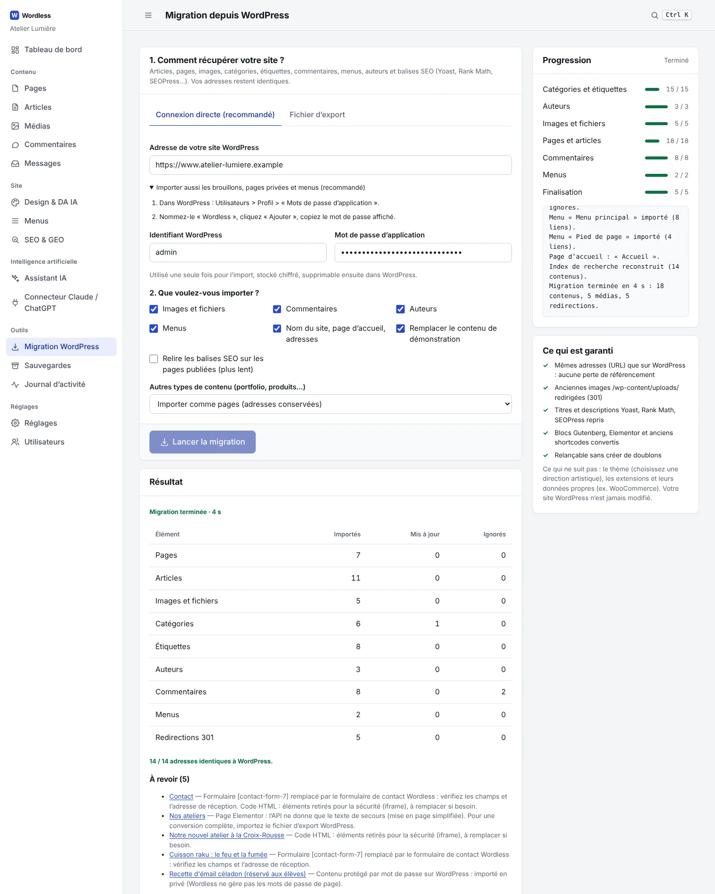

**Ce qui est repris :**

| Élément | Détail |
|---|---|
| Pages, articles, autres types | Statuts conservés (publié, brouillon, programmé, privé), dates, auteurs, image à la une, hiérarchie des pages. |
| Mise en page | Blocs Gutenberg (y compris les FAQ de Yoast et Rank Math) et mises en page Elementor convertis en blocs Wordless ; codes courts interprétés ; contenus Divi, WPBakery ou Avada repris avec une mise en page simplifiée ; formulaires Contact Form 7 remplacés par le formulaire intégré. |
| Référencement | Titres, descriptions, mots-clés, noindex, URL canoniques et images de partage de Yoast SEO, Rank Math, SEOPress, All in One SEO et The SEO Framework. |
| Images et fichiers | Téléchargés, convertis en WebP en 3 tailles, liens réécrits dans les contenus. |
| Adresses | **Identiques**. Redirections 301 automatiques pour les anciennes adresses d'images (`/wp-content/uploads/…`, y compris les variantes `-300x200` et `-scaled`), les liens `?p=123`, les pages de pièces jointes et les anciens slugs. |
| Le reste | Catégories, étiquettes, commentaires (fils de discussion sur 3 niveaux), menus et leurs emplacements, auteurs, nom du site, page d'accueil, structure des permaliens, fuseau horaire. |

**Fiabilité :** votre site WordPress n'est jamais modifié ; après une coupure ou un onglet fermé, un bouton « Reprendre la migration » la relance là où elle s'était arrêtée ; la relancer ne crée aucun doublon ; un rapport liste tout ce qui a été importé, ignoré ou mérite une relecture. Le site de démonstration (7 pages, 11 articles, 5 images, 8 commentaires, 2 menus) a été migré en 3 secondes, avec 14 adresses sur 14 identiques. Le module est couvert par 309 vérifications automatiques. Guide détaillé : [docs/MIGRATION.md](docs/MIGRATION.md).

---

## Tableau de bord à 360°

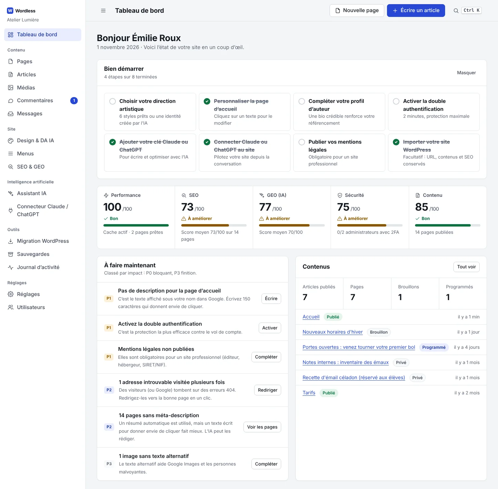

Dès la connexion, vous savez où en est votre site et quoi faire ensuite :

- **Bien démarrer** : les étapes clés de la mise en route, cochées au fur et à mesure.
- **Santé du site sur 5 piliers** : performance, SEO, GEO, sécurité, contenu, chacun noté sur 100 avec son explication.
- **À faire maintenant** : les actions classées par impact (P0 bloquant à P3 finition), avec le bouton qui y mène.
- **Contenus** : publiés, brouillons, programmés, et les dernières modifications.

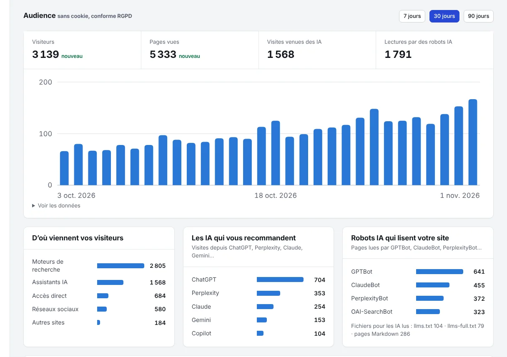

- **Audience sans cookie ni bandeau** : visiteurs et pages vues sur 7, 30 ou 90 jours. L'identifiant de visite est un hachage qui change chaque jour : impossible de suivre quelqu'un d'un jour à l'autre, aucune donnée personnelle conservée.
- **D'où viennent les visiteurs** : moteurs de recherche, assistants IA, réseaux sociaux, autres sites, accès direct.
- **Les IA qui vous recommandent** (ChatGPT, Perplexity, Claude, Gemini, Copilot) et **les robots d'IA qui lisent votre site**, avec les lectures de `llms.txt` et des pages Markdown.
- **Pages les plus vues**, **activité récente** (qui a fait quoi, y compris l'IA connectée) et **contenus à rafraîchir**.

*Captures réalisées sur le site de démonstration, avec des données de visite de démonstration.*

---

## Sécurité

<picture>
  <source media="(prefers-color-scheme: dark)" srcset=".github/assets/security-fr-dark.svg">
  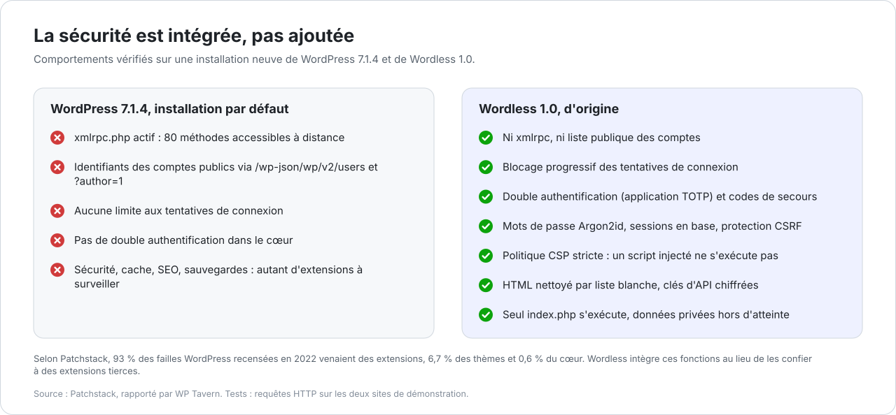
</picture>

Les comportements de WordPress ci-dessus ont été vérifiés sur une installation neuve de la version 7.1.4. Ceux de Wordless aussi : `xmlrpc.php` et l'API des comptes n'existent pas, `?author=1` ne révèle rien, et la connexion se bloque après 6 essais ratés (15 minutes, durée doublée en cas de récidive).

**Ce que Wordless intègre :**

- **Connexion** : mots de passe Argon2id, vérification à temps constant, blocage progressif par adresse et par compte, **double authentification** par application (Google Authenticator, Microsoft Authenticator, 1Password…) avec codes de secours, obligation de la 2FA activable pour les administrateurs.
- **Sessions** : stockées en base, cookie aléatoire, déconnexion de tous vos autres appareils, protection CSRF sur chaque action.
- **Navigateur** : politique de sécurité du contenu (CSP) stricte sur le site public, avec l'empreinte du seul style autorisé ; en-têtes de sécurité (protection contre l'intégration en iframe, anti-sniffing, politique de référent, caméra, micro et géolocalisation désactivés, HSTS en option).
- **Contenu** : HTML nettoyé par liste blanche, y compris celui produit par l'IA ou importé de WordPress ; iframes limitées à YouTube et Vimeo.
- **Serveur** : seul `index.php` s'exécute ; dossiers `data/` et `core/` inaccessibles depuis le web ; aucun script exécutable dans `media/`.
- **Données** : clés d'IA, mots de passe SMTP et identifiants WordPress chiffrés (libsodium, ou AES-GCM de secours) ; protection SSRF contre les requêtes vers le réseau interne ; sauvegarde automatique quotidienne (14 conservées).

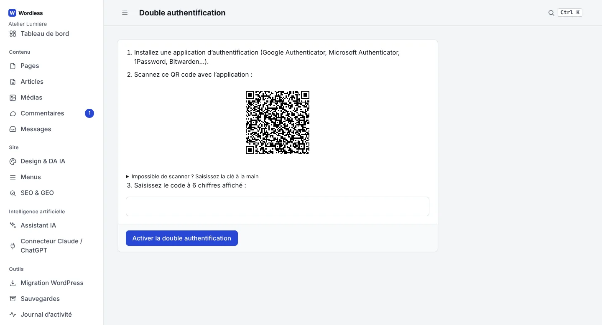

---

## Installation

**Configuration requise :** PHP 8.1 ou plus récent avec `pdo_sqlite`, `mbstring`, `dom` et `xml` (présents chez la plupart des hébergeurs). Recommandés : `gd` (WebP), `curl` (IA, migration), `intl`, `sodium`, `zip`. L'installeur vérifie tout et indique ce qui manque.

### Sur un hébergement mutualisé (FTP)

1. [Téléchargez Wordless](https://github.com/Jacckisback/Wordless/raw/main/dist/wordless-1.0.1.zip) (620 Ko) et décompressez l'archive. Nouveautés : [CHANGELOG.md](CHANGELOG.md).
2. Envoyez le contenu du dossier `wordless/` à la racine de votre site par FTP.
3. Ouvrez l'adresse du site : renseignez le nom du site, votre e-mail et un mot de passe. **C'est tout** : la base de données se crée seule.

### En ligne de commande

```bash
php bin/wordless install --url=https://exemple.fr --email=vous@exemple.fr --password="Une phrase de passe longue" --site="Mon site"
```

Pour essayer en local : `php -S 127.0.0.1:8080 router.php`

### Serveur web

**Apache et LiteSpeed** : le fichier `.htaccess` fourni gère tout (réécritures, protection des dossiers privés, cache des fichiers statiques, compression).

<details>
<summary><b>Nginx</b> : exemple de configuration</summary>

```nginx
server {
    server_name exemple.fr;
    root /var/www/wordless;
    index index.php;

    # Dossiers privés et fichiers cachés (sauf .well-known)
    location ~ ^/(data|core|tests|bin)(/|$) { return 403; }
    location ~ /\.(?!well-known/) { return 403; }

    # Médias : jamais de PHP, cache long
    location ^~ /media/ {
        location ~ \.php$ { return 403; }
        expires 1y;
        add_header Cache-Control "public, immutable";
        try_files $uri =404;
    }

    # Seul index.php s'exécute
    location = /index.php {
        include fastcgi_params;
        fastcgi_param SCRIPT_FILENAME $document_root/index.php;
        fastcgi_param HTTP_AUTHORIZATION $http_authorization;
        fastcgi_pass unix:/run/php/php8.3-fpm.sock;
    }
    location ~ \.php$ { return 403; }

    location / { try_files $uri /index.php$is_args$args; }
}
```
</details>

<details>
<summary><b>Derrière un CDN ou un proxy</b> (Cloudflare, répartiteur de charge…)</summary>

Wordless voit alors l'adresse du proxy au lieu de celle de vos visiteurs : le blocage après des tentatives de connexion répétées et les statistiques les confondraient tous. Déclarez les adresses de vos proxys dans `data/config.php` (adresses exactes ou plages CIDR, IPv4 et IPv6) :

```php
'trusted_proxies' => ['173.245.48.0/20', '103.21.244.0/22' /* … */],
```

ou dans la variable d'environnement `WL_TRUSTED_PROXIES` (valeurs séparées par des virgules). Pour Cloudflare, la liste complète est publiée sur [cloudflare.com/ips](https://www.cloudflare.com/ips/). Wordless lit alors l'adresse réelle dans `X-Forwarded-For` (à défaut `X-Real-IP`), en ne faisant confiance qu'aux proxys déclarés. Sans déclaration, ces en-têtes sont ignorés : un visiteur ne peut pas se faire passer pour un autre.
</details>

### Ligne de commande

```bash
php bin/wordless help                          # toutes les commandes
php bin/wordless backup --full                 # sauvegarde base + médias (zip)
php bin/wordless cache:clear                   # vider le cache de pages
php bin/wordless import:wxr export.xml         # migrer un fichier d'export WordPress
php bin/wordless import:wp https://site.fr     # migrer par l'API d'un site WordPress
php bin/wordless mcp:key <e-mail> --label="Claude Code"   # clé API pour un client MCP
php bin/wordless user:password <e-mail> <mot de passe>
php bin/wordless user:2fa-reset <e-mail>       # téléphone perdu
```

### Mises à jour, sauvegardes, déménagement

- Les tâches de fond (publications programmées, sauvegardes, nettoyage) se lancent seules lors des visites. Une tâche planifiée `*/10 * * * * php bin/wordless cron` est possible sur un site très peu visité.
- **Mettre à jour** : remplacez `index.php`, `router.php`, `.htaccess`, `core/`, `admin/` et `themes/default/`, sans toucher à `data/` ni `media/`. La base est mise à niveau automatiquement.
- **Déménager** : tout votre site tient dans deux dossiers, `data/` (base, réglages, sauvegardes) et `media/` (fichiers).

---

## Pour les développeurs

- **Zéro dépendance** : PHP 8.1+ pur, pas de Composer, pas de framework, pas d'étape de build. Chargement automatique `Wordless\Classe` vers `core/Classe.php`.
- **SQLite** (mode WAL) avec recherche plein texte FTS5, migrations de schéma automatiques.
- **Architecture** : point d'entrée unique, cache rapide servi avant l'application, routeur, vues PHP, thème en templates PHP et CSS minifié intégré. Détails : [docs/ARCHITECTURE.md](docs/ARCHITECTURE.md).
- **Extensions** : actions et filtres (`wl_on`, `wl_filter`, `wl_do`), activées en ligne de commande. Voir [plugins/README.md](plugins/README.md).
- **Tests** : `php tests/migrate_test.php` (309 vérifications, sur un vrai site WordPress de test généré par `tests/wp-fixture/build.sh`) `php tests/mcp_test.php` (249 vérifications) et `php tests/core_test.php` (51 vérifications sur les correctifs de la version 1.0.1).
- **Traductions** : les textes source sont en français ; `php bin/i18n-missing.php` liste ce qui manque dans `core/lang/en.php` et `core/lang/es.php`.
- **Archive d'installation** : `php bin/build-dist.php`.
- **Schémas de ce README** : `python3 .github/assets/src/make_diagrams.py` (chiffres dans `metrics.json`).

---

## Questions fréquentes

<details>
<summary><b>Wordless est-il gratuit ?</b></summary>

Oui. C'est un logiciel libre sous licence GNU AGPL-3.0 : vous pouvez l'utiliser, y compris pour un usage commercial, l'étudier et le modifier. Si vous proposez une version modifiée à d'autres personnes, y compris en ligne comme service hébergé, vous devez publier son code source sous la même licence. L'IA est facturée directement par votre fournisseur (Anthropic ou OpenAI), selon votre consommation.
</details>

<details>
<summary><b>Vais-je perdre mon référencement en quittant WordPress ?</b></summary>

C'est tout l'objet de l'outil de migration : les adresses de vos pages restent identiques, les anciennes formes d'adresses sont redirigées en 301, les titres et descriptions de votre extension SEO sont repris. Après la bascule, déclarez le plan du site (`/sitemap.xml`) dans la Google Search Console et surveillez le journal des pages introuvables quelques jours.
</details>

<details>
<summary><b>Mes extensions WordPress vont-elles fonctionner ?</b></summary>

Non : Wordless n'exécute pas le code de WordPress. Mais l'essentiel de ce que font les extensions courantes est déjà intégré (voir le [tableau des équivalences](#ce-que-wordpress-délègue-à-des-extensions-wordless-lintègre)). Pour un besoin spécifique, Wordless accepte des extensions légères écrites en PHP.
</details>

<details>
<summary><b>Puis-je vendre en ligne ?</b></summary>

Pas encore : Wordless n'a pas de module e-commerce. Les produits WooCommerce ne sont pas importés (le rapport de migration les signale). Si la boutique est au cœur de votre activité, restez sur WordPress ou utilisez une solution e-commerce dédiée.
</details>

<details>
<summary><b>Quel hébergement faut-il ?</b></summary>

Un hébergement PHP 8.1 classique suffit, mutualisé compris. Pas de base MySQL à créer : SQLite est intégrée à PHP. Les pages étant servies depuis le cache, la plupart des visites ne sollicitent ni l'application ni la base.
</details>

<details>
<summary><b>Mes contenus sont-ils envoyés à l'IA ?</b></summary>

Uniquement quand vous lancez une action IA, et seulement le contenu concerné, vers le fournisseur dont vous avez fourni la clé. Rien n'est envoyé en arrière-plan. Le connecteur MCP, lui, n'agit que lorsque votre assistant le sollicite, avec les droits du compte qui l'a autorisé, et chaque action est journalisée.
</details>

<details>
<summary><b>Le site peut-il être multilingue ?</b></summary>

L'interface d'administration est disponible en français, anglais et espagnol. Pour le contenu, l'assistant IA crée des traductions (français, anglais, espagnol, allemand, italien, portugais) sous forme de brouillons reliés à l'original, à relire avant publication.
</details>

---

## Limites connues

Wordless 1.0 est jeune. Pour décider en connaissance de cause :

- **Pas d'e-commerce ni de multisite** ; pas d'écosystème d'extensions comparable à celui de WordPress.
- **Non repris lors d'une migration** : produits WooCommerce, champs ACF, taxonomies personnalisées (signalés dans le rapport) ; les contenus protégés par mot de passe deviennent privés.
- **Interface d'administration** en trois langues (français, anglais, espagnol).
- **Connecteur MCP** : la connexion OAuth suppose Wordless à la racine du domaine (une redirection suffit sinon) ; les clients à adresse de retour personnalisée (`cursor://`…) utilisent une clé API.
- **Les mesures** ont été faites sur le serveur intégré de PHP : sur votre hébergement, les valeurs absolues changeront, les écarts resteront du même ordre.

---

## Licence et crédits

Copyright © 2026 Thierry Gustin.

Wordless est un logiciel libre : vous pouvez le redistribuer et le modifier selon les termes de la **GNU Affero General Public License, version 3** (AGPL-3.0-only), publiée par la Free Software Foundation. Il est distribué sans aucune garantie. Texte complet : [LICENSE](LICENSE). Si vous modifiez Wordless et le mettez à disposition d'autres personnes, pensez à changer l'adresse `WL_SOURCE` dans `core/bootstrap.php` pour qu'elle pointe vers votre code source.

Le directeur artistique reprend et adapte les principes et règles d'[Impeccable](https://github.com/pbakaus/impeccable) de Paul Bakaus, publiés sous licence Apache 2.0 (voir `core/Ai/impeccable/NOTICE`).

Wordless n'est ni affilié ni approuvé par la WordPress Foundation ou Automattic. WordPress est une marque de la WordPress Foundation. Claude est une marque d'Anthropic ; ChatGPT est une marque d'OpenAI.
